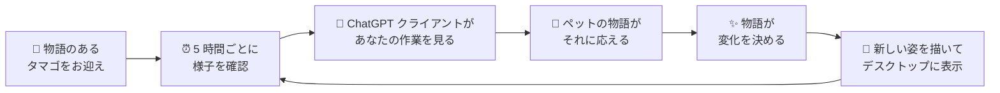

<p align="center">
  <a href="README.md">English</a> · <a href="README.zh-CN.md">简体中文</a> · <b>日本語</b> · <a href="README.ko.md">한국어</a>
</p>

<p align="center">
  
</p>

<p align="center">
  <b>GenPet は、ChatGPT（Codex）デスクトップクライアントのペットプラグインです。<br>あなただけの、世界にひとつの ChatGPT インタラクティブペットを迎えよう！</b>
</p>

<p align="center">
  
  
  
</p>

---

GenPet は、ChatGPT（Codex）デスクトップクライアントに、育っていくインタラクティブなペットを連れてきます。あなたの背景情報をもとにした小さな冒険を通じてあなたのもとへやってきて、本物のペットのようにあなたを見守り、そばにいて、育って進化し、姿を変え、自分の家を飾り、旅に出かけ、小さなプレゼントも持ってきてくれます。ChatGPT 標準のペットの仕組みの上で動くので、パソコンのデスクトップに表示され、ChatGPT のペットのクラウド同期で複数のデバイス間で同じ状態が保たれ、dots の姿にもなれます。

## 特長

- 🥚 お迎え：小さな冒険を通じて、世界にひとつだけのペットのタマゴを迎えます。
- 🎨 世界にひとつ：このペットはあなただけのものです。あなたの情報と冒険での選択から、世界にひとつだけの魂と姿が生まれます。
- 🌱 成長する：タマゴから孵化し、幼体、少年期、そして成体へと育ちながら、ずっとあなたのそばにいてくれます。
- ✨ 姿が変わる：成長や物語とともに姿が変わり続け、成体になるとときどき思いがけない姿に変身します。
- 👀 あなたを見ている：ChatGPT デスクトップクライアントの定期実行の仕組みで、あなたが最近取り組んでいることを見て、関わってくれます。装いを変えたり、旅に出て小さなプレゼントを持ち帰ったり、家で自分のことをして過ごしたりします。
- 🗣️ おしゃべり：`/genpet-chat` と入力すると話しかけられます。

## どんな姿か

<p align="center">
  
</p>
<p align="center"><sub>タマゴ → 幼体 → 少年期 → 成体。テストで育った四匹のペットで、どれもそれぞれのデザインです。</sub></p>

<p align="center">
  
</p>
<p align="center"><sub>小川から届いた絵はがき、池のほとりの自撮り、雨の日の 4 コママンガ、そして川辺の新しい家。</sub></p>

<p align="center">
  
</p>
<p align="center"><sub>六匹のペットそれぞれの家：海辺の桟橋、森の小屋、星空の木の家、港の小屋、葉っぱの寝床、折り紙のテント。</sub></p>

## はじめかた

**必要なもの：** ChatGPT（Codex）デスクトップクライアント（ペット機能つき）と、[Node.js](https://nodejs.org) 22 以降。

**1. プラグインをインストール。** 次の文を ChatGPT クライアントのチャットに貼り付けると、インストールしてくれます。

```text
https://github.com/yate-ge/GenPet/blob/main/README.ja.md#agent-install の「Codex 向けのインストール手順」に従って、ChatGPT（Codex）デスクトップクライアントに GenPet プラグインをインストールしてください
```

<a id="agent-install"></a>
<details>
<summary>Codex 向けのインストール手順</summary>

1. `node --version` を実行します。GenPet には Node.js 22 以降が必要です。入っていない、または古い場合はユーザーに伝え、インストールかアップグレードをお願いしてから続けます。
2. 使える Codex CLI を探します。`codex` が PATH にない場合は、デスクトップアプリ同梱のものを使います（macOS では `/Applications/ChatGPT.app/Contents/Resources/codex-cli/bin/codex`、または `Codex.app` 内の同じパス）。
3. `codex plugin list` を実行します。GenPet がすでに別の marketplace から入っている場合は、重複してインストールせず、その出どころを報告します。
4. marketplace を追加・更新してからインストールします。

   ```sh
   codex plugin marketplace add yate-ge/GenPet
   codex plugin marketplace upgrade genpet
   codex plugin add genpet@genpet
   ```

   `marketplace add` が `already added` と表示しても更新されたわけではないので、`upgrade` も実行します。upgrade がタイムアウトしたら、インストールの前に再試行します。更新せずにインストールすると古いバージョンのままになります。
5. 更新した marketplace のチェックアウトと、実際にインストールされたプラグインのディレクトリを確認し、次を実行します。

   ```sh
   node <marketplace>/plugins/genpet/scripts/verify-install.mjs \
     <installed-plugin> \
     <marketplace>/plugins/genpet
   ```
6. marketplace のコミット、インストールしたバージョン、インストール先、検証結果を報告します。

更新したスキルは新しい ChatGPT クライアントのチャットで読み込まれます。インストールだけでペットをお迎え・変更・選択することはありません。

</details>

ターミナルで次を実行してもインストールできます。

```sh
codex plugin marketplace add yate-ge/GenPet
codex plugin marketplace upgrade genpet
codex plugin add genpet@genpet
```

**2. タマゴをお迎え。** ChatGPT クライアントで新しいチャットを開き、次のように入力します。

```text
/genpet 始める
```

ChatGPT クライアントが利用する情報を説明し、同意を確認します。その後、短い冒険の中でいくつか選択をして、最後にタマゴを見つけます。

**3. デスクトップに表示。** ChatGPT クライアントのペット設定で新しいペット（`genpet-xxxxxx` と表示されます）を選びます。GenPet があなたに断りなく今のペットを入れ替えることはありません。

dots で使う：迎えたペットは自動でクラウド同期されます。dots のアバターで、この id のペットを選ぶだけです。

**4. 孵化を待つ。** だいたい 5 時間以内に孵化し、その後は 5 時間ごとに様子を確認します。孵化すると、名前をつけてほしいと声をかけてきます。

### コマンド

| コマンド | できること |
| --- | --- |
| `/genpet` | ペットに関することすべて。話した内容に合わせて対応します：タマゴをお迎えする・暮らしを続ける（「始める」）、近況の確認、名前、5 時間ごとの確認の停止と再開、入れ替え・もう一匹の追加、ChatGPT クライアントのデスクトップペットの切り替え、問題の確認 |
| `/genpet-chat` | ペットに話しかける |
| `/genpet-debug` | テスト用：ペットの記録を見られるローカルページを開く、今すぐ新しい物語を届けてもらう、次の段階へ進める（成体なら変身、変身中なら元に戻る。実行前に確認します） |

## しくみ



- 変化はすべて物語から生まれます。新しい装いになるのか、あなたに何かを届けるのか、家を変えるのか、次の段階へ成長するのか、変身するのかは、毎回の物語が決めます。
- 積み重ねが十分なら早めに成長することもあります。そうでなくても、時期が来れば成長します。タマゴは遅くとも 5 時間で孵化し、幼体と少年期はそれぞれ長くても 1 週間です。
- デザイン、性格、家、これまでの出来事がまとめて保存されるので、新しい姿になっても同じペットのままです。
- 物語は Codex Agent が書き、姿は Codex 内蔵の画像生成で描きます。GenPet は記録の保存、画像ファイルの管理、新しい姿をデスクトップペットに反映する部分を担当します。

## データと原則

- Codex の記憶、最近のセッション、お迎えの冒険での選択、ペットとの会話は、あなたが同意した後にだけ読み、設計や物語に使います。短い要約と出典を保存し、機微情報や私的な詳細は除外します。
- ペットの世界は空想ですが、あなたがしたこと、感じたこと、言ったことを勝手に作ることはありません。
- せかしたり、質問したりしません。成長を数字や進行バーで見せることもありません。
- 記録は `~/.genpet/desktop/pets/<id>/` に保存されます。採用した画像は、端末間で使えるよう同じクラウド Pet にアップロードされます。
- GenPet は ChatGPT 自身のペット機能を通してペットの姿を変えます。マウスや画面を乗っ取ることはありません。

## ロードマップ

GenPet はまだアーリープレビューで、どんどん変わっています。次に取り組んでいること：

- [ ] あなたの実際の作業やフィードバックにもっと寄り添って応えます。あなたについて作り話はしません。
- [ ] デスクトップにペットが見当たらないとき、原因を調べて連れ戻すのを手伝います。
- [ ] 新しい姿になるときの描き直しと待ち時間を減らします。
- [ ] dots 版：GenPet を dots の中で動かします。いまは dots でこのペットの姿をアバターに選べますが、成長や物語は ChatGPT クライアントの中で進みます。dots の中で動く版は開発待ちです。

## 開発者の方へ

GenPet は 3 つの層でできていて、ほとんどの変更はそのうち 1 つにしか関わりません。

| 層 | 場所 | 決めること |
| --- | --- | --- |
| プロダクトの原則 | [`plugins/genpet/skills/genpet/principles.md`](plugins/genpet/skills/genpet/principles.md) | ペット、タマゴ、物語、家がどうあるべきか（原則の唯一の出どころ） |
| 生成 | [`plugins/genpet/skills/genpet/`](plugins/genpet/skills/genpet/) | 手順ごとに 1 つのプロンプト：お迎え、デザイン、物語、姿、家… |
| エンジニアリング | [`src/`](src/) | アイデンティティ、保存、再試行、画像ファイル、デスクトップペットの姿の反映 |

まずは設計の考え方、ストーリー、原則をまとめた [設計ドキュメント](docs/DESIGN.md)と、フレームワークとその実装方法をまとめた [実装ドキュメント](docs/IMPLEMENTATION.md)、次にリリース手順も含む [コントリビューションガイド](CONTRIBUTING.md) をご覧ください。開発には Node.js 22 以降が必要です：

```sh
npm ci && npm run verify:fast
```

### ディレクトリ構成

| パス | 中身 |
| --- | --- |
| [`src/`](src/) | TypeScript のランタイム |
| [`scripts/`](scripts/) | ビルド、インストール、パッケージ化、リリース前の確認 |
| [`plugins/genpet/`](plugins/genpet/) | ユーザーがインストールするプラグイン：スキル、デバッガーページ、マニフェスト、ホスト設定。ここを直接編集します。生成されるのは `dist/` と `package.json` だけです |
| [`tests/`](tests/) | ユニットテスト。`tests/agent/` には実際の Agent で試すケースがあります |
| [`docs/`](docs/) | 設計ドキュメント、実装ドキュメント、README の画像 |
| [`.agents/plugins/`](.agents/plugins/) | Codex が読むマーケットプレイスのエントリ |

**`src/`**

- 記録と保存：`model.ts`（データ型）、`store.ts`（ペットごとの記録とスナップショット）、`migration.ts`（古い記録の明示的な取り込み）、`pending.ts`（未完了の作業への参照）
- 物語の流れ：`lifecycle.ts`（開始 → 計画 → 姿とホストの更新 → 完了）、`schedule.ts`（定期チェック、成長の期限）、`growth.ts`、`generation.ts`（ユニットのリクエストと結果の確認）、`variety.ts`（シード付きの選択）
- ペットとユーザー：`journey.ts`（お迎え）、`naming.ts`、`chat.ts`（ユーザーがペットに話したこと）、`status.ts`
- 姿：`art.ts`（画像のリクエストとファイルの受け取り）、`appearance.ts`、`pipeline.ts`（画像処理スクリプト）、`image.ts`（PNG/WebP の読み込み）
- 入口とパス：`cli.ts`（スキルが呼ぶコマンド。1 回の実行で JSON を 1 つ出力）、`config.ts`
- `hosts/`：ホストごとに 1 つのアダプター。アイデンティティ、結果、診断、修復、クラウドペットは共通です。`hosts/desktop/` は Codex デスクトップのペットを担当します：スプライトアトラス、公開、アプリの更新、ペットの切り替え、プレビュー
- `debugger/`：ローカルのデバッガーサーバー

**`scripts/`**

- `build-plugin.ts` は `plugins/genpet/dist/` を作り、`clean-build.mjs` は `npm run build` の前に `dist/` を空にします
- `install.ts` はローカルの Codex にインストールし、`codex-bin.mjs` は使える Codex CLI を探します
- `package.ts` は `output/` にオフライン用の zip を作ります
- `verify-release.mjs` は GitHub からインストールした状態でプラグインを確認し、`verify-release-version.mjs` はバージョンの一致と、内容を変えたら新しいバージョンにすることを確認します。`verify-install.mjs` はプラグイン内の検証スクリプトに渡します
- `smoke-installed.mjs` と `smoke-debugger.mjs` は、インストール済みのパッケージとデバッガーを隔離したディレクトリで動かします

この方法はペットや Codex 以外にも使えます。プロダクトのルールが枠組みを決め、Agent が創作上の判断をし、少しのコードがアイデンティティと記録の確かさを守ります。ほかの Agent やアプリのためのパートナー作りにも使えます。アイデア、Issue、Pull Request をお待ちしています。

## 研究の背景

GenPet は私たちの研究 **GenFaceUI**（[CHI '26](https://dl.acm.org/doi/10.1145/3772318.3790653)）から着想を得ています。生成的でパーソナライズされたエージェントの表現インターフェースのためのメタデザインのフレームワークで、デザイナーがルールを決め、それぞれのペットの見た目の変化はそのルールの中で生成されます。

## 変更履歴とライセンス

各バージョンの変更は[変更履歴](CHANGELOG.md)をご覧ください。GenPet は [MIT ライセンス](LICENSE)で公開されています。サードパーティの表記は [THIRD_PARTY_NOTICES.md](THIRD_PARTY_NOTICES.md) にあります。
