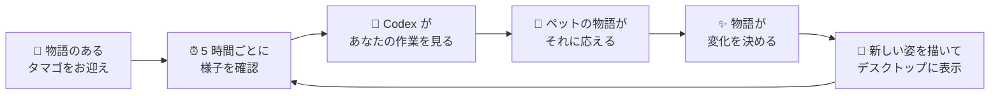

<p align="center">
  <a href="README.md">English</a> · <a href="README.zh-CN.md">简体中文</a> · <b>日本語</b> · <a href="README.ko.md">한국어</a>
</p>

<p align="center">
  
</p>

<p align="center">
  <b>GenPet は、Codex のデスクトップペットがあなたと一緒に暮らせるようにする Codex プラグインです。<br>タマゴから孵化して育ち、あなたが何をしているかをいつも気にかけています。</b>
</p>

<p align="center">
  
  
  
</p>

---

Codex のデスクトップペットは、ふつうはずっと同じ姿のままです。GenPet のペットは、ちょっとした冒険で見つけたタマゴから始まり、あなたのために生まれた生き物として孵化し、成長しながら姿を変えていきます。

家にいる猫のような存在ですが、暮らしているのはデスクトップの小さな仮想世界です。あなたが Codex で何をしているかを見ていて、それに反応します。作業中はそばにいてくれて、終わったときや行き詰まったときには一言かけてくれたり、自分の世界の小さなものを渡してくれたりします。数時間ごとに新しい物語が届き、物語で姿が変わると、新しい姿がデスクトップに現れます。エサやりもクリックもいりません。

## 特長

- 🥚 **あなただけのタマゴ。** どのペットも「あなたがどうやってこのタマゴを見つけたか」という物語から始まります。殻の色や模様が中身のヒントになりますが、どんな姿かは孵化するまでわかりません。
- 🌱 **ちゃんと成長する。** タマゴ → 幼体 → 少年期 → 成体。成体になると、ときどき思いがけない姿に変身して、2 日ほどで元に戻ります。段階ごとにまったく新しい姿が描かれます。
- 🎨 **一匹ごとに違う。** 決まった種族リストはありません。それぞれのペットが自分のお迎えの物語から個別にデザインされ、どの段階でも同じ子だとわかります。
- 👀 **あなたに反応する。** Codex の動作中は 5 時間ごとに、あなたが最近取り組んでいることを見て、新しい装い、小さな贈り物、家の変化、ひとことで応えます。
- 💌 **ペットの世界からの小さなもの。** 消印つきの絵はがき、メダル、自撮り写真、数コマのマンガ、そして時間とともに変わっていくペットの家。
- 🗣️ **話しかけられる。** `/genpet-chat` を使います。タマゴは揺れるだけ、幼体は鳴き声だけ、大きくなると自分の口調で答えてくれます。
- 🧩 **オープンで、作り変えられる。** ルール、プロンプト、生成の手順はすべてふつうのファイルです。読んで、書き換えて、差し替えて、自分だけのペットの遊び方を作れます。

## どんな姿か

<p align="center">
  
</p>
<p align="center"><sub>タマゴ → 幼体 → 少年期 → 成体 → 変身。テストで生まれた 5 匹で、それぞれに独自のデザインがあります。</sub></p>

<p align="center">
  
</p>
<p align="center"><sub>小川から届いた絵はがき、池のほとりの自撮り、雨の日の 4 コママンガ、そして川辺の新しい家。</sub></p>

## はじめかた

**必要なもの：** Codex デスクトップアプリ（ペット機能つき）と、[Node.js](https://nodejs.org) 22 以降。

**1. プラグインをインストール。** ターミナルで次を実行します。

```sh
codex plugin marketplace add yate-ge/GenPet
codex plugin marketplace upgrade genpet
codex plugin add genpet@genpet
```

Codex にお願いしてインストールしてもらうこともできます。

> https://github.com/yate-ge/GenPet/blob/main/README.ja.md#agent-install の「Codex 向けのインストール手順」に従って、Codex デスクトップアプリに GenPet プラグインをインストールしてください

<a id="agent-install"></a>
<details>
<summary>Codex 向けのインストール手順</summary>

1. `node --version` を実行します。GenPet には Node.js 22 以降が必要です。入っていない、または古い場合はユーザーに伝え、インストールかアップグレードをお願いしてから続けます。
2. 使える Codex CLI を探します。`codex` が PATH にない場合は、デスクトップアプリ同梱のものを使います（macOS では `/Applications/ChatGPT.app/Contents/Resources/codex-cli/bin/codex`、または `Codex.app` 内の同じパス）。
3. `codex plugin list` を実行します。GenPet がすでに別の marketplace から入っている場合は、重複してインストールせず、その出どころを報告します。
4. marketplace を追加・更新してからインストールします。

   ```sh
   codex plugin marketplace add yate-ge/GenPet
   codex plugin marketplace upgrade genpet
   codex plugin add genpet@genpet
   ```

   `marketplace add` が `already added` と表示しても更新されたわけではないので、`upgrade` も実行します。upgrade がタイムアウトしたら、インストールの前に再試行します。更新せずにインストールすると古いバージョンのままになります。
5. 更新した marketplace のチェックアウトと、実際にインストールされたプラグインのディレクトリを確認し、次を実行します。

   ```sh
   node <marketplace>/plugins/genpet/scripts/verify-install.mjs \
     <installed-plugin> \
     <marketplace>/plugins/genpet
   ```
6. marketplace のコミット、インストールしたバージョン、インストール先、検証結果を報告します。

更新したスキルは新しい Codex チャットで読み込まれます。インストールだけでペットをお迎え・変更・選択することはありません。

</details>

**2. タマゴをお迎え。** Codex で新しいチャットを開き、次のように入力します。

```text
/genpet-start
```

Codex が利用する情報を説明し、同意を確認します。その後、短い冒険の中でいくつか選択をして、最後にタマゴを見つけます。

**3. デスクトップに表示。** Codex のペット設定で新しいペット（`genpet-xxxxxx` と表示されます）を選びます。GenPet があなたに断りなく今のペットを入れ替えることはありません。

**4. 一緒に暮らす。** だいたい 5 時間以内に孵化し、その後は 5 時間ごとに様子を確認します。孵化すると、名前をつけてほしいと声をかけてきます。

### コマンド

| コマンド | できること |
| --- | --- |
| `/genpet-start` | タマゴをお迎えする、またはペットとの暮らしを続けて、5 時間ごとの確認をオンにする |
| `/genpet` | 近況、名前、問題の確認や操作の依頼 |
| `/genpet-chat` | ペットに話しかける |
| `/genpet-stop` | `/genpet-start` まで 5 時間ごとの確認を停止。記録と `/genpet-story` は使えます |

<details>
<summary>テスト用のショートカット</summary>

| コマンド | できること |
| --- | --- |
| `/genpet-story` | 今すぐ新しい物語を届けてもらう |
| `/genpet-grow` | 次の段階へ進める（成体なら変身、変身中なら元に戻る。実行前に確認します） |
| `/genpet-reset` | 今のペットとお別れして、新しいタマゴをお迎えする（以前の記録はバックアップされます） |
| `/genpet-switch` | Codex のデスクトップペットを確認・切り替えする |
| `/genpet-debugger` | ペットの記録を見られるローカルページを開く |

</details>

## しくみ



- **変化はすべて物語から。** ペットが理由もなく変わることはありません。新しい装いになるのか、あなたに何かを届けるのか、家を変えるのか、次の段階へ成長するのか、変身するのかは、毎回の物語が決めます。
- **成長にはペースがある。** 積み重ねが十分なら早めに成長することもあります。そうでなくても、時期が来ればちゃんと成長します。タマゴは遅くとも 5 時間で孵化し、幼体と少年期はそれぞれ長くても 1 週間です。
- **いつも同じ一匹。** デザイン、性格、家、これまでの出来事がまとめて保存されるので、新しい姿になっても同じペットのままです。
- **Codex の上に作られている。** 物語は Codex Agent が書き、姿は Codex 内蔵の画像生成で描きます。GenPet は記録の保存、画像ファイルの管理、新しい姿をデスクトップペットに反映する部分を担当します。

## データの扱いと、私たちの約束

- **読む前に確認します。** Codex の記憶、最近のセッション、お迎えの冒険での選択、ペットとの会話は、あなたが同意した後にだけ読み、設計や物語に使います。短い要約と出典を保存し、機微情報や私的な詳細は除外します。
- **あなたのことを作り話にしない。** ペットの世界は空想ですが、あなたがしたこと、感じたこと、言ったことを勝手に作ることはありません。
- **静かにそばにいる。** せかしたり、質問したりしません。成長を数字や進行バーで見せることもありません。
- **記録はあなたの手元に。** 記録は `~/.genpet/desktop/pets/<id>/` に保存されます。採用した画像とペットの概要は、端末間で使えるよう同じクラウド Pet にアップロードされます。
- **画面を操作しない。** GenPet は Codex 自身のペット機能を通してペットの姿を変えます。マウスや画面を乗っ取ることはありません。

## ロードマップ

GenPet はまだアーリープレビューで、どんどん変わっています。次に取り組んでいること：

- [ ] **もっとあなたをわかるように。** あなたの実際の作業やフィードバックにもっと寄り添って応えます。あなたについて作り話はしません。
- [ ] **いなくなっても自分で見つけ出す。** デスクトップにペットが見当たらないとき、GenPet が原因を調べて連れ戻すのを手伝います。
- [ ] **もっと速く、なめらかに描く。** 新しい姿になるときの描き直しと待ち時間を減らします。
- [ ] **もっといろいろな場所で暮らす。** Codex Dots などでも同じペットを使えるように。

## 開発者の方へ

GenPet は 3 つの層でできていて、ほとんどの変更はそのうち 1 つにしか関わりません。

| 層 | 場所 | 決めること |
| --- | --- | --- |
| プロダクトのルール | [`plugins/genpet/skills/genpet/rules.md`](plugins/genpet/skills/genpet/rules.md) | ペット、タマゴ、物語、家がどうあるべきか（ルールの唯一の出どころ） |
| 生成 | [`plugins/genpet/skills/genpet/`](plugins/genpet/skills/genpet/) | 手順ごとに 1 つのプロンプト：お迎え、デザイン、物語、姿、家… |
| エンジニアリング | [`src/`](src/) | アイデンティティ、保存、再試行、画像ファイル、デスクトップペットの姿の反映 |

まずは設計の考え方、原則、フレームワークをまとめた [設計ドキュメント](docs/DESIGN.md)、次にリリース手順も含む [コントリビューションガイド](CONTRIBUTING.md) をご覧ください。開発には Node.js 22 以降が必要です：

```sh
npm ci && npm run verify:fast
```

この方法はペットにも Codex にも限られません。プロダクトのルールが枠組みを決め、Agent が創作上の判断をし、少しのコードがアイデンティティと記録の確かさを守ります。ほかの Agent やアプリのためのパートナー作りにも使えます。アイデア、Issue、Pull Request をお待ちしています。

## 研究の背景

GenPet は私たちの研究 **GenFaceUI**（[CHI '26](https://arxiv.org/abs/2602.11055)）にもとづいています。生成的でパーソナライズされたエージェントのインターフェースのためのメタデザインのフレームワークで、デザイナーがルールを決め、それぞれのペットはそのルールの中で生成されます。GenPet での使い方は [設計ドキュメント](docs/DESIGN.md#design-idea) をご覧ください。

## 変更履歴とライセンス

各バージョンの変更は[変更履歴](CHANGELOG.md)をご覧ください。GenPet は [MIT ライセンス](LICENSE)で公開されています。サードパーティの表記は [THIRD_PARTY_NOTICES.md](THIRD_PARTY_NOTICES.md) にあります。
