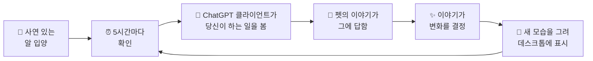

<p align="center">
  <a href="README.md">English</a> · <a href="README.zh-CN.md">简体中文</a> · <a href="README.ja.md">日本語</a> · <b>한국어</b>
</p>

<p align="center">
  
</p>

<p align="center">
  <b>GenPet은 ChatGPT(Codex) 데스크톱 클라이언트의 펫 플러그인입니다.<br>나만의 세상에 하나뿐인 ChatGPT 인터랙티브 펫을 입양하세요!</b>
</p>

<p align="center">
  
  
  
</p>

---

GenPet은 ChatGPT(Codex) 데스크톱 클라이언트에 함께 자라나는 인터랙티브 펫을 가져옵니다. 당신의 배경 정보를 바탕으로 한 짧은 모험을 통해 당신 곁에 오고, 진짜 펫처럼 당신을 지켜보고 곁에 있어 주며, 자라고 진화하고, 모습을 바꾸고, 자기 집을 꾸미고, 여행을 떠나고, 작은 선물도 가져다줍니다. ChatGPT 자체의 펫 시스템 위에서 동작하므로 컴퓨터 데스크톱에 표시되고, ChatGPT의 펫 클라우드 동기화로 여러 기기에서 같은 상태를 유지하며, dots의 모습이 될 수도 있습니다.

## 특징

- 🥚 입양: 짧은 모험을 통해 세상에 하나뿐인 펫의 알을 입양합니다.
- 🎨 세상에 하나뿐: 이 펫은 오직 당신의 것입니다. 당신의 정보와 모험에서의 선택으로, 세상에 하나뿐인 영혼과 모습을 갖게 됩니다.
- 🌱 성장: 알에서 깨어나 유년기, 소년기를 거쳐 성체가 되기까지, 내내 당신 곁에서 함께 자랍니다.
- ✨ 모습이 바뀜: 자라면서, 그리고 이야기가 쌓이면서 모습이 계속 바뀌고, 성체가 되면 가끔 뜻밖의 모습으로 변신합니다.
- 👀 당신을 지켜봄: ChatGPT 데스크톱 클라이언트의 정기 실행 기능으로 당신이 요즘 무슨 일을 하는지 보고 교감합니다. 옷차림을 바꾸고, 여행을 떠나 작은 선물을 가져다주고, 집에서 자기만의 시간을 보내기도 합니다.
- 🗣️ 대화: `/genpet-chat`을 입력하면 대화할 수 있습니다.

## 어떤 모습일까

<p align="center">
  
</p>
<p align="center"><sub>알 → 유년기 → 소년기 → 성체. 테스트에서 자란 네 마리 펫이며 저마다 디자인이 다릅니다.</sub></p>

<p align="center">
  
</p>
<p align="center"><sub>개울가에서 보낸 엽서, 연못가 셀카, 비 오는 날의 네 컷 만화, 그리고 강가의 새집.</sub></p>

<p align="center">
  
</p>
<p align="center"><sub>여섯 마리 펫 각자의 집: 바닷가 부두, 숲속 오두막, 별밤 나무집, 항구 오두막, 잎사귀 둥지, 종이 텐트.</sub></p>

## 빠른 시작

**준비물:** ChatGPT(Codex) 데스크톱 클라이언트(펫 기능 포함)과 [Node.js](https://nodejs.org) 22 이상.

**1. 플러그인 설치.** 다음 문장을 ChatGPT 클라이언트 대화에 붙여 넣으면 설치해 줍니다.

```text
https://github.com/yate-ge/GenPet/blob/main/README.ko.md#agent-install 의 「Codex용 설치 단계」에 따라 ChatGPT(Codex) 데스크톱 클라이언트에 GenPet 플러그인을 설치해 줘
```

<a id="agent-install"></a>
<details>
<summary>Codex용 설치 단계</summary>

1. `node --version`을 실행합니다. GenPet에는 Node.js 22 이상이 필요합니다. 없거나 버전이 낮으면 사용자에게 알리고, 설치하거나 업그레이드한 뒤 계속하도록 요청합니다.
2. 쓸 수 있는 Codex CLI를 찾습니다. `codex`가 PATH에 없으면 데스크톱 앱에 포함된 것을 씁니다(macOS에서는 `/Applications/ChatGPT.app/Contents/Resources/codex-cli/bin/codex` 또는 `Codex.app` 안의 같은 경로).
3. `codex plugin list`를 실행합니다. GenPet이 이미 다른 marketplace에서 설치되어 있으면 중복 설치하지 말고 그 출처를 알려 줍니다.
4. marketplace를 추가하고 새로 고친 뒤 설치합니다.

   ```sh
   codex plugin marketplace add yate-ge/GenPet
   codex plugin marketplace upgrade genpet
   codex plugin add genpet@genpet
   ```

   `marketplace add`가 `already added`라고 해도 새로 고친 것이 아니므로 `upgrade`를 실행합니다. upgrade가 시간 초과되면 설치 전에 다시 시도합니다. 새로 고치지 않고 설치하면 이전 버전이 설치됩니다.
5. 새로 고친 marketplace 체크아웃과 실제로 설치된 플러그인 디렉터리를 찾은 뒤 다음을 실행합니다.

   ```sh
   node <marketplace>/plugins/genpet/scripts/verify-install.mjs \
     <installed-plugin> \
     <marketplace>/plugins/genpet
   ```
6. marketplace 커밋, 설치된 버전, 설치 경로, 검증 결과를 알려 줍니다.

업데이트된 스킬은 새 ChatGPT 클라이언트 대화에서 불러옵니다. 설치만으로 펫을 입양하거나 바꾸거나 선택하지 않습니다.

</details>

터미널에서 직접 실행할 수도 있습니다.

```sh
codex plugin marketplace add yate-ge/GenPet
codex plugin marketplace upgrade genpet
codex plugin add genpet@genpet
```

**2. 알 입양하기.** ChatGPT 클라이언트에서 새 대화를 열고 다음을 입력합니다.

```text
/genpet 시작
```

ChatGPT 클라이언트가 사용하는 정보를 설명하고 동의를 확인합니다. 그다음 짧은 모험에서 몇 가지를 선택하고, 마지막에 알을 발견합니다.

**3. 데스크톱에 띄우기.** ChatGPT 클라이언트의 펫 설정에서 새 펫(`genpet-xxxxxx`로 표시됨)을 선택합니다. GenPet은 묻지 않고 지금의 펫을 바꾸지 않습니다.

dots에서 쓰기: 입양한 펫은 자동으로 클라우드에 동기화됩니다. dots의 아바타에서 이 id의 펫을 선택하면 됩니다.

**4. 부화를 기다리기.** 보통 5시간 안에 알에서 깨어나고, 그 뒤로는 5시간마다 확인합니다. 깨어나면 이름을 지어 달라고 부탁합니다.

### 명령어

| 명령어 | 하는 일 |
| --- | --- |
| `/genpet` | 펫에 관한 모든 일을 말한 내용에 맞춰 처리합니다: 알 입양 또는 이어서 키우기("시작"), 근황, 이름, 5시간마다 하는 확인의 중지와 재개, 교체 또는 한 마리 더 입양, ChatGPT 클라이언트 데스크톱 펫 바꾸기, 문제 확인 |
| `/genpet-chat` | 펫에게 말 걸기 |
| `/genpet-debug` | 테스트용: 펫의 기록을 볼 수 있는 로컬 페이지 열기, 지금 바로 새 이야기 받기, 다음 단계로 건너뛰기 (성체라면 변신, 변신 중이면 원래대로. 실행 전에 확인합니다) |

## 작동 방식



- 모든 변화는 이야기에서 나옵니다. 새 옷차림을 하는지, 당신에게 무언가를 가져다주는지, 집이 바뀌는지, 다음 단계로 자라는지, 변신하는지는 매번 이야기가 정합니다.
- 쌓인 것이 충분하면 일찍 자랄 수도 있습니다. 그렇지 않더라도 때가 되면 자랍니다. 알은 늦어도 5시간 안에 깨어나고, 유년기와 소년기는 각각 길어야 일주일입니다.
- 디자인, 성격, 집, 지나온 일이 함께 저장되므로 새 모습이 되어도 여전히 같은 펫입니다.
- 이야기는 Codex Agent가 쓰고, 모습은 Codex에 내장된 이미지 생성으로 그립니다. GenPet은 기록 저장, 이미지 파일 관리, 새 모습을 데스크톱 펫에 적용하는 일을 맡습니다.

## 데이터와 원칙

- Codex 기억, 최근 세션, 입양 모험에서의 선택, 펫과의 대화는 당신이 동의한 뒤에만 읽고 설계와 이야기에 사용합니다. 짧은 요약과 출처를 저장하고 민감한 정보와 사적인 상세 내용은 제외합니다.
- 펫의 세계는 상상이지만, 당신이 한 일이나 느낀 감정, 한 말을 지어내지는 않습니다.
- 재촉하거나 질문하지 않고, 성장을 숫자나 진행 막대로 보여 주지도 않습니다.
- 기록은 `~/.genpet/desktop/pets/<id>/`에 저장됩니다. 채택한 이미지는 기기 간 사용을 위해 같은 클라우드 Pet에 업로드됩니다.
- GenPet은 ChatGPT 자체의 펫 기능으로 펫의 모습을 바꾸며, 마우스나 화면을 대신 조작하지 않습니다.

## 로드맵

GenPet은 아직 초기 프리뷰 단계이며 빠르게 바뀌고 있습니다. 다음으로 준비하고 있는 것들:

- [ ] 당신의 실제 작업과 피드백에 더 가까이 반응합니다. 당신에 대해 지어내지는 않습니다.
- [ ] 데스크톱에서 펫이 보이지 않으면 원인을 찾아 다시 데려오도록 돕습니다.
- [ ] 새 모습을 그릴 때 다시 그리는 일과 기다리는 시간을 줄입니다.
- [ ] dots 버전: GenPet을 dots 안에서 실행합니다. 지금은 dots에서 이 펫의 모습을 아바타로 고를 수 있고, 성장과 이야기는 여전히 ChatGPT 클라이언트 안에서 이루어집니다. dots 안에서 실행되는 버전은 개발 예정입니다.

## 개발자를 위해

GenPet은 세 개의 층으로 되어 있고, 대부분의 변경은 그중 하나만 건드립니다.

| 층 | 위치 | 정하는 것 |
| --- | --- | --- |
| 제품 원칙 | [`plugins/genpet/skills/genpet/principles.md`](plugins/genpet/skills/genpet/principles.md) | 펫, 알, 이야기, 집이 어때야 하는지 (원칙의 유일한 출처) |
| 생성 | [`plugins/genpet/skills/genpet/`](plugins/genpet/skills/genpet/) | 단계마다 하나의 프롬프트: 입양, 디자인, 이야기, 모습, 집… |
| 엔지니어링 | [`src/`](src/) | 정체성, 저장, 재시도, 이미지 파일, 데스크톱 펫에 새 모습 적용 |

먼저 설계 생각, 스토리, 원칙을 담은 [설계 문서](docs/DESIGN.md)와 프레임워크와 구현 방법을 담은 [구현 문서](docs/IMPLEMENTATION.md)를 보고, 이어서 릴리스 절차도 담긴 [기여 가이드](CONTRIBUTING.md)를 확인하세요. 개발에는 Node.js 22 이상이 필요합니다:

```sh
npm ci && npm run verify:fast
```

### 디렉터리 구성

| 경로 | 들어 있는 것 |
| --- | --- |
| [`src/`](src/) | TypeScript 런타임 |
| [`scripts/`](scripts/) | 빌드, 설치, 패키징, 릴리스 점검 |
| [`plugins/genpet/`](plugins/genpet/) | 사용자가 설치하는 플러그인: 스킬, 디버거 페이지, 매니페스트, 호스트 설정. 여기를 직접 수정합니다. 생성되는 것은 `dist/`와 `package.json`뿐입니다 |
| [`tests/`](tests/) | 단위 테스트. `tests/agent/`에는 실제 Agent로 시험하는 케이스가 있습니다 |
| [`docs/`](docs/) | 설계 문서, 구현 문서, README 이미지 |
| [`.agents/plugins/`](.agents/plugins/) | Codex가 읽는 마켓플레이스 항목 |

**`src/`**

- 기록과 저장: `model.ts`(데이터 타입), `store.ts`(펫별 기록과 스냅샷), `migration.ts`(옛 기록을 명시적으로 가져오기), `pending.ts`(끝나지 않은 작업에 대한 참조)
- 이야기 흐름: `lifecycle.ts`(시작 → 계획 → 모습과 호스트 업데이트 → 완료), `schedule.ts`(정기 점검, 성장 기한), `growth.ts`, `generation.ts`(유닛 요청과 결과 확인), `variety.ts`(시드 기반 선택)
- 펫과 사용자: `journey.ts`(입양), `naming.ts`, `chat.ts`(사용자가 펫에게 한 말), `status.ts`
- 모습: `art.ts`(이미지 요청과 파일 받기), `appearance.ts`, `pipeline.ts`(이미지 처리 스크립트), `image.ts`(PNG/WebP 읽기)
- 진입점과 경로: `cli.ts`(스킬이 호출하는 명령, 한 번에 JSON 하나를 출력), `config.ts`
- `hosts/`: 호스트마다 어댑터 하나. 정체성, 결과, 진단, 복구, 클라우드 펫은 공통입니다. `hosts/desktop/`은 Codex 데스크톱 펫을 맡습니다: 스프라이트 아틀라스, 게시, 앱 새로고침, 펫 전환, 미리보기
- `debugger/`: 로컬 디버거 서버

**`scripts/`**

- `build-plugin.ts`는 `plugins/genpet/dist/`를 만들고, `clean-build.mjs`는 `npm run build` 전에 `dist/`를 비웁니다
- `install.ts`는 로컬 Codex에 설치하고, `codex-bin.mjs`는 쓸 수 있는 Codex CLI를 찾습니다
- `package.ts`는 `output/`에 오프라인용 zip을 만듭니다
- `verify-release.mjs`는 GitHub에서 설치한 상태 그대로 플러그인을 점검하고, `verify-release-version.mjs`는 버전이 일치하는지와 내용이 바뀌면 새 버전이어야 하는지를 확인합니다. `verify-install.mjs`는 플러그인 안의 검증 스크립트로 넘깁니다
- `smoke-installed.mjs`와 `smoke-debugger.mjs`는 설치된 패키지와 디버거를 격리된 디렉터리에서 실행합니다

이 방식은 펫과 Codex 밖에서도 쓸 수 있습니다. 제품 규칙이 경계를 정하고, Agent가 창작에 관한 결정을 내리며, 적은 양의 코드가 정체성과 기록을 믿을 수 있게 지킵니다. 다른 Agent와 앱을 위한 동반자를 만드는 데도 쓸 수 있습니다. 아이디어, Issue, Pull Request를 환영합니다.

## 연구 배경

GenPet은 저희 연구 **GenFaceUI**([CHI '26](https://dl.acm.org/doi/10.1145/3772318.3790653))에서 영감을 받았습니다. 생성형·개인화 에이전트 표현 인터페이스를 위한 메타디자인 프레임워크로, 디자이너가 규칙을 정하고 각 펫의 모습 변화는 그 규칙 안에서 생성됩니다.

## 변경 기록과 라이선스

버전별 변경 사항은 [변경 기록](CHANGELOG.md)을 참고하세요. GenPet은 [MIT 라이선스](LICENSE)로 공개됩니다. 서드파티 고지는 [THIRD_PARTY_NOTICES.md](THIRD_PARTY_NOTICES.md)에 있습니다.
