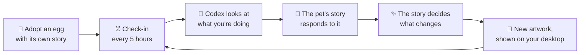

<p align="center">
  <b>English</b> · <a href="README.zh-CN.md">简体中文</a> · <a href="README.ja.md">日本語</a> · <a href="README.ko.md">한국어</a>
</p>

<p align="center">
  
</p>

<p align="center">
  <b>GenPet is a Codex plugin that gives your desktop pet a life with you:<br>it hatches from an egg, grows up, and keeps an eye on what you're doing.</b>
</p>

<p align="center">
  
  
  
</p>

---

A Codex desktop pet normally looks the same forever. A GenPet starts as an egg you find on a short adventure, hatches into a creature designed for you, and keeps changing as it grows up.

It is like a cat living in your house, except it lives in a small virtual world on your desktop. It watches what you're doing in Codex and reacts: it keeps you company while you work, says something when you finish or get stuck, or hands you a small thing from its world. Every few hours you get a new story, and when the story changes how it looks, the new look shows up on your desktop. You don't need to feed it or click on it.

## Highlights

- 🥚 **An egg that's only yours.** Every pet begins with the story of how you found its egg. The shell's colors and patterns hint at what's inside, but you only find out when it hatches.
- 🌱 **It really grows up.** Egg → hatchling → juvenile → adult. As an adult it occasionally transforms into something surprising that wears off after a couple of days. Every stage gets brand-new artwork.
- 🎨 **No two pets alike.** There's no fixed species list. Each pet is designed from its own adoption story, and stays recognizably itself from stage to stage.
- 👀 **It reacts to you.** Every 5 hours, while Codex is running, it looks at what you've been working on and responds with a new outfit, a small gift, a change at home or a few words.
- 💌 **Little things from its world.** Postcards with stamps, medals, selfies, short comics, and a home that changes as time goes by.
- 🗣️ **Talk to it.** Use `/genpet-chat`. An egg can only wobble, a hatchling only makes sounds, and older pets answer in their own voice.
- 🧩 **Open and hackable.** The rules, prompts and generation steps are plain files you can read, edit and swap to build your own kind of pet.

## What it looks like

<p align="center">
  
</p>
<p align="center"><sub>Egg → Hatchling → Juvenile → Adult → Special form. Five pets from our test runs, each with its own design.</sub></p>

<p align="center">
  
</p>
<p align="center"><sub>A postcard from a creek, a selfie by the pond, a rainy-day comic, and a new home by the river.</sub></p>

## Quick start

**You'll need** the Codex desktop app (with Pets) and [Node.js](https://nodejs.org) 22 or newer.

**1. Install the plugin.** Run this in your terminal:

```sh
codex plugin marketplace add yate-ge/GenPet
codex plugin marketplace upgrade genpet
codex plugin add genpet@genpet
```

Or ask Codex to do it for you:

> Install the GenPet plugin for the Codex desktop app by following the install steps for Codex in https://github.com/yate-ge/GenPet#agent-install

<a id="agent-install"></a>
<details>
<summary>Install steps for Codex</summary>

1. Run `node --version`. GenPet needs Node.js 22 or newer. If it is missing or older, tell the user and ask them to install or upgrade it before continuing.
2. Find a working Codex CLI. If `codex` is not on the PATH, use the one bundled with the desktop app (on macOS, `/Applications/ChatGPT.app/Contents/Resources/codex-cli/bin/codex` or the same path inside `Codex.app`).
3. Run `codex plugin list`. If GenPet already comes from another marketplace, report that source instead of installing a duplicate.
4. Add and refresh the marketplace, then install:

   ```sh
   codex plugin marketplace add yate-ge/GenPet
   codex plugin marketplace upgrade genpet
   codex plugin add genpet@genpet
   ```

   `marketplace add` reporting `already added` is not a refresh; still run `upgrade`. If the upgrade times out, retry it before installing, because installing without a refresh keeps the old version.
5. Find the refreshed marketplace checkout and the actual installed plugin directory, then run:

   ```sh
   node <marketplace>/plugins/genpet/scripts/verify-install.mjs \
     <installed-plugin> \
     <marketplace>/plugins/genpet
   ```
6. Report the marketplace commit, installed version, installed path and verification result.

The updated skills load in a new Codex chat. Installing does not adopt, change or select a pet.

</details>

**2. Adopt your egg.** Open a new Codex chat and type:

```text
/genpet-start
```

Codex explains the data it uses and asks you to confirm. You then make a few choices on a short adventure that ends with an egg.

**3. Show it on your desktop.** In Codex's pet settings, pick the new pet (listed as `genpet-xxxxxx`). GenPet doesn't change your current pet without asking.

**4. Let it live with you.** It hatches within about 5 hours and checks in every 5 hours after that. Once it hatches, you'll be invited to give it a name.

### Commands

| Command | What it does |
| --- | --- |
| `/genpet-start` | Adopt an egg, or carry on with your pet, and turn on its 5-hour check-ins |
| `/genpet` | Check on your pet, name it, diagnose a problem or request an action |
| `/genpet-chat` | Talk to your pet |
| `/genpet-stop` | Pause the scheduled check-ins until `/genpet-start`; its records and `/genpet-story` stay available |

<details>
<summary>Testing shortcuts</summary>

| Command | What it does |
| --- | --- |
| `/genpet-story` | Get a new story right now |
| `/genpet-grow` | Skip ahead to the next stage (an adult transforms, or changes back if transformed; asks first) |
| `/genpet-reset` | Say goodbye and adopt a new egg (the old record is backed up) |
| `/genpet-switch` | List or switch the Codex desktop pet |
| `/genpet-debugger` | Open a local page to browse your pet's records |

</details>

## How it works



- **Stories drive every change.** A pet never changes "just because". Each story decides whether it gets a new outfit, brings you something, changes its home, grows to the next stage, or transforms.
- **Growth has a pace.** A pet can grow early when there's enough to show for it. If not, it still grows on time: an egg hatches within 5 hours, and the hatchling and juvenile stages each last up to a week.
- **One pet, one identity.** Its design, personality, home and history are saved together, so every new look is still the same pet.
- **Built on Codex.** The Codex Agent writes the stories and draws the artwork with its built-in image generation. GenPet handles the records, the artwork files and putting the new look on your desktop pet.

## Your data and our principles

- **Asks before reading.** Codex memories, your recent sessions, your choices in the adoption adventure and your chats with the pet inform its design and stories, only after you confirm. Short summaries and source references are saved; sensitive and private details are left out.
- **Never makes things up about you.** The pet's world is imaginary, but it won't invent what you did, felt or said.
- **Quiet company.** It doesn't nag, ask you questions or show growth as a number or progress bar.
- **Records stay with you.** They live under `~/.genpet/desktop/pets/<id>/`. The accepted sprite sheet and Pet brief are uploaded to the same cloud Pet so it works across devices.
- **No screen control.** GenPet changes your pet through Codex's own pet features and never takes over your mouse or screen.

## Roadmap

GenPet is in early preview and changing quickly. Next up:

- [ ] **Knows you better.** Reacts more closely to your real work and feedback, without inventing anything about you.
- [ ] **Finds itself when it's missing.** If your pet doesn't show up on your desktop, GenPet works out why and helps bring it back.
- [ ] **Faster and smoother art.** Fewer retries and less waiting when your pet gets a new look.
- [ ] **More places to live.** Using the same pet in Codex Dots and beyond.

## For developers

GenPet has three layers, and most changes touch only one of them:

| Layer | Where | What it decides |
| --- | --- | --- |
| Product rules | [`plugins/genpet/skills/genpet/rules.md`](plugins/genpet/skills/genpet/rules.md) | What a pet, egg, story and home must be (the single source of rules) |
| Generation | [`plugins/genpet/skills/genpet/`](plugins/genpet/skills/genpet/) | One prompt per step: adoption, design, story, artwork, home… |
| Engineering | [`src/`](src/) | Identity, saving, retries, artwork files and desktop updates |

Start with the [design document](docs/DESIGN.md) for the idea, principles and framework, then see [contributing](CONTRIBUTING.md), which also covers releasing. Development needs Node.js 22+:

```sh
npm ci && npm run verify:fast
```

The approach isn't tied to pets or to Codex: product rules set the boundaries, an Agent makes the creative choices, and a small amount of code keeps identity and records reliable. You could use it to build companions for other agents and apps. Ideas, issues and pull requests are welcome.

## Research background

GenPet builds on our research on **GenFaceUI** ([CHI '26](https://arxiv.org/abs/2602.11055)), a meta-design framework for generative, personalized agent interfaces: designers set the rules, and each pet is generated within them. The [design document](docs/DESIGN.md#design-idea) explains how GenPet applies it.

## Changelog and license

See the [changelog](CHANGELOG.md) for what each version changed. GenPet is released under the [MIT license](LICENSE); third-party notices are in [THIRD_PARTY_NOTICES.md](THIRD_PARTY_NOTICES.md).
