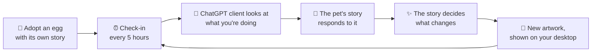

<p align="center">
  <b>English</b> · <a href="README.zh-CN.md">简体中文</a> · <a href="README.ja.md">日本語</a> · <a href="README.ko.md">한국어</a>
</p>

<p align="center">
  
</p>

<p align="center">
  <b>GenPet is a pet plugin for the ChatGPT (Codex) desktop client:<br>adopt your one-of-a-kind interactive ChatGPT pet!</b>
</p>

<p align="center">
  
  
  
</p>

---

GenPet brings an interactive pet that grows up to the ChatGPT (Codex) desktop client: based on your background information, it comes to you through a short adventure, and like a real pet it watches you, keeps you company, grows and evolves, changes how it looks, decorates its own home, goes out on trips, and brings you small gifts. It is built on ChatGPT's own pet system, so it shows on your computer desktop, stays in sync across your devices through ChatGPT's pet cloud sync, and can also be the face of dots.

## Features

- 🥚 Adopt: go on a short adventure and adopt a one-of-a-kind pet egg.
- 🎨 One of a kind: this pet belongs to you alone. Shaped by your information and the choices you make on the adventure, it has a soul and a look no one else in the world has.
- 🌱 Grows up: it hatches from the egg, grows into a hatchling, then a juvenile, then an adult, and keeps you company all the way.
- ✨ Changes its look: its appearance keeps changing as it grows and as its stories unfold, and an adult sometimes transforms into something surprising.
- 👀 Watches you: using the ChatGPT desktop client's scheduling, it notices what you've been busy with and interacts with you: it puts on different outfits, goes out on trips and brings you small gifts, or gets on with its own life at home.
- 🗣️ Chat: type `/genpet-chat` to talk with it.

## What it looks like

<p align="center">
  
</p>
<p align="center"><sub>Egg → Hatchling → Juvenile → Adult. Four pets from our test runs, each with its own design.</sub></p>

<p align="center">
  
</p>
<p align="center"><sub>A postcard from a creek, a selfie by the pond, a rainy-day comic, and a new home by the river.</sub></p>

<p align="center">
  
</p>
<p align="center"><sub>Six pets, six homes: a seaside dock, a forest hut, a starry treehouse, a harbor cabin, a leaf nest and a paper tent.</sub></p>

## Quick start

**You'll need** the ChatGPT (Codex) desktop client (with Pets) and [Node.js](https://nodejs.org) 22 or newer.

**1. Install the plugin.** Paste this into a ChatGPT client chat and it installs it for you:

```text
Install the GenPet plugin for the ChatGPT (Codex) desktop client by following the install steps for Codex in https://github.com/yate-ge/GenPet#agent-install
```

<a id="agent-install"></a>
<details>
<summary>Install steps for Codex</summary>

1. Run `node --version`. GenPet needs Node.js 22 or newer. If it is missing or older, tell the user and ask them to install or upgrade it before continuing.
2. Find a working Codex CLI. If `codex` is not on the PATH, use the one bundled with the desktop app (on macOS, `/Applications/ChatGPT.app/Contents/Resources/codex-cli/bin/codex` or the same path inside `Codex.app`).
3. Run `codex plugin list`. If GenPet already comes from another marketplace, report that source instead of installing a duplicate.
4. Add and refresh the marketplace, then install:

   ```sh
   codex plugin marketplace add yate-ge/GenPet
   codex plugin marketplace upgrade genpet
   codex plugin add genpet@genpet
   ```

   `marketplace add` reporting `already added` is not a refresh; still run `upgrade`. If the upgrade times out, retry it before installing, because installing without a refresh keeps the old version.
5. Find the refreshed marketplace checkout and the actual installed plugin directory, then run:

   ```sh
   node <marketplace>/plugins/genpet/scripts/verify-install.mjs \
     <installed-plugin> \
     <marketplace>/plugins/genpet
   ```
6. Report the marketplace commit, installed version, installed path and verification result.

The updated skills load in a new ChatGPT client chat. Installing does not adopt, change or select a pet.

</details>

Or run these commands in your terminal:

```sh
codex plugin marketplace add yate-ge/GenPet
codex plugin marketplace upgrade genpet
codex plugin add genpet@genpet
```

**2. Adopt your egg.** Open a new ChatGPT client chat and type:

```text
/genpet start
```

The ChatGPT client explains the data it uses and asks you to confirm. You then make a few choices on a short adventure that ends with an egg.

**3. Show it on your desktop.** In the ChatGPT client's pet settings, pick the new pet (listed as `genpet-xxxxxx`). GenPet doesn't change your current pet without asking.

Using it in dots: once adopted, the pet syncs to the cloud automatically. In dots, pick the pet with this id as your avatar.

**4. Wait for it to hatch.** It hatches within about 5 hours and checks in every 5 hours after that. Once it hatches, you'll be invited to give it a name.

### Commands

| Command | What it does |
| --- | --- |
| `/genpet` | Everything about your pet, by what you ask for: adopt an egg or carry on ("start"), check on it, name it, pause or resume the 5-hour check-ins, replace it or adopt another, switch the ChatGPT client desktop pet, or diagnose a problem |
| `/genpet-chat` | Talk to your pet |
| `/genpet-debug` | For testing: open a local page to browse your pet's records, get a new story right now, or skip ahead to the next stage (an adult transforms, or changes back if transformed; asks first) |

## How it works



- Every change comes from a story. Each story decides whether the pet gets a new outfit, brings you something, changes its home, grows to the next stage or transforms.
- A pet can grow early when there's enough to show for it. If not, it still grows on time: an egg hatches within 5 hours, and the hatchling and juvenile stages each last up to a week.
- A pet's design, personality, home and history are saved together, so every new look is still the same pet.
- The Codex Agent writes the stories and draws the artwork with its built-in image generation. GenPet handles the records, the artwork files and putting the new look on your desktop pet.

## Data and principles

- Codex memories, your recent sessions, your choices in the adoption adventure and your chats with the pet inform its design and stories, only after you confirm. Short summaries and source references are saved; sensitive and private details are left out.
- The pet's world is imaginary, but it won't invent what you did, felt or said.
- It doesn't nag, ask you questions or show growth as a number or progress bar.
- Records live under `~/.genpet/desktop/pets/<id>/`. The accepted sprite sheet is uploaded to the same cloud Pet so it works across devices.
- GenPet changes your pet through ChatGPT's own pet features and never takes over your mouse or screen.

## Roadmap

GenPet is in early preview and changing quickly. Next up:

- [ ] Reacts more closely to your real work and feedback, without inventing anything about you.
- [ ] If your pet doesn't show up on your desktop, GenPet works out why and helps bring it back.
- [ ] Fewer retries and less waiting when your pet gets a new look.
- [ ] A dots version: GenPet running inside dots. Today you can pick the pet's look as your avatar in dots, while its growth and stories still happen in the ChatGPT client. The version that runs inside dots is yet to be built.

## For developers

GenPet has three layers, and most changes touch only one of them:

| Layer | Where | What it decides |
| --- | --- | --- |
| Product principles | [`plugins/genpet/skills/genpet/principles.md`](plugins/genpet/skills/genpet/principles.md) | What a pet, egg, story and home must be (the single source of principles) |
| Generation | [`plugins/genpet/skills/genpet/`](plugins/genpet/skills/genpet/) | One prompt per step: adoption, design, story, artwork, home… |
| Engineering | [`src/`](src/) | Identity, saving, retries, artwork files and desktop updates |

Start with the [design document](docs/DESIGN.md) for the idea, the stories and the principles and the [implementation document](docs/IMPLEMENTATION.md) for the framework and how it is built, then see [contributing](CONTRIBUTING.md), which also covers releasing. Development needs Node.js 22+:

```sh
npm ci && npm run verify:fast
```

### Project layout

| Path | What's in it |
| --- | --- |
| [`src/`](src/) | The TypeScript runtime |
| [`scripts/`](scripts/) | Build, install, package and release checks |
| [`plugins/genpet/`](plugins/genpet/) | The plugin people install: skills, debugger page, manifest, host config. Edit it in place; only `dist/` and `package.json` are generated |
| [`tests/`](tests/) | Unit tests. `tests/agent/` holds the cases for testing with a real Agent |
| [`docs/`](docs/) | Design and implementation documents, README images |
| [`.agents/plugins/`](.agents/plugins/) | The marketplace entry Codex reads |

**`src/`**

- Records and saving: `model.ts` (data types), `store.ts` (per-Pet records and snapshots), `migration.ts` (explicit import of old records), `pending.ts` (references to unfinished work)
- Story flow: `lifecycle.ts` (begin → plan → artwork and host update → finish), `schedule.ts` (periodic checks, growth deadlines), `growth.ts`, `generation.ts` (unit requests and result checks), `variety.ts` (seeded choices)
- Pet and user: `journey.ts` (adoption), `naming.ts`, `chat.ts` (what the user said to the pet), `status.ts`
- Artwork: `art.ts` (image requests and accepting files), `appearance.ts`, `pipeline.ts` (image helper scripts), `image.ts` (PNG/WebP reading)
- Entry and paths: `cli.ts` (the commands the skills call; each prints one JSON result), `config.ts`
- `hosts/`: one adapter per host. Shared code covers identity, results, diagnosis, repair and the cloud Pet. `hosts/desktop/` handles the Codex desktop Pet: sprite atlas, publishing, refreshing the app, switching Pets and preview
- `debugger/`: the local debugger server

**`scripts/`**

- `build-plugin.ts` builds `plugins/genpet/dist/`; `clean-build.mjs` clears `dist/` before `npm run build`
- `install.ts` installs into your local Codex; `codex-bin.mjs` finds a working Codex CLI
- `package.ts` makes the offline zip under `output/`
- `verify-release.mjs` checks the plugin as people install it from GitHub; `verify-release-version.mjs` checks versions match and changed contents get a new version; `verify-install.mjs` forwards to the verifier inside the plugin
- `smoke-installed.mjs` and `smoke-debugger.mjs` run the installed package and the debugger in an isolated directory

The same approach works beyond pets and Codex: product rules set the boundaries, an Agent makes the creative choices, and a small amount of code keeps identity and records reliable. You could use it to build companions for other agents and apps. Ideas, issues and pull requests are welcome.

## Research background

GenPet is inspired by our research on **GenFaceUI** ([CHI '26](https://dl.acm.org/doi/10.1145/3772318.3790653)): a meta-design framework for generative, personalized agent expression interfaces. Designers set the rules, and each pet's appearance changes are generated within them.

## Changelog and license

See the [changelog](CHANGELOG.md) for what each version changed. GenPet is released under the [MIT license](LICENSE); third-party notices are in [THIRD_PARTY_NOTICES.md](THIRD_PARTY_NOTICES.md).
