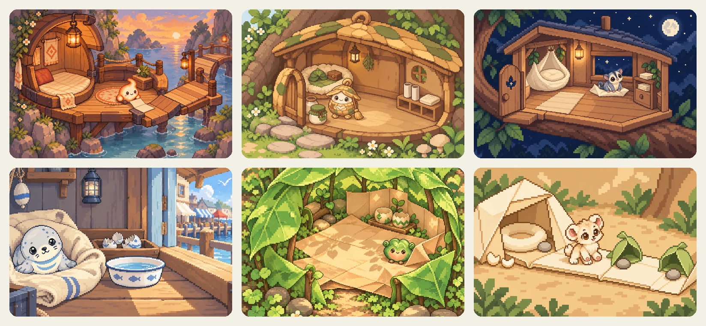
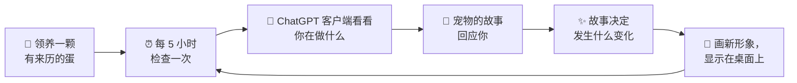

<p align="center">
  <a href="README.md">English</a> · <b>简体中文</b> · <a href="README.ja.md">日本語</a> · <a href="README.ko.md">한국어</a>
</p>

<p align="center">
  
</p>

<p align="center">
  <b>GenPet 是 ChatGPT（Codex）桌面客户端的宠物插件：<br>领养你独一无二的 ChatGPT 互动宠物！</b>
</p>

<p align="center">
  
  
  
</p>

---

GenPet 为 ChatGPT（Codex）桌面客户端带来一只会成长的互动宠物：它根据你的背景信息，通过一次小冒险来到你身边，像真正的宠物一样观察你、陪伴你，会长大、进化、换上新的形象，布置自己的家，还会出门旅行，也会给你带来小礼物。它基于 ChatGPT 自带的宠物系统，显示在电脑桌面上，通过 ChatGPT 的宠物云同步在多台设备间保持一致，也可以作为 dots 的形象。

## 特点

- 🥚 领养：通过一次小冒险，领养一颗独一无二的宠物蛋。
- 🎨 独一无二：这只宠物只属于你。它根据你的信息和冒险中的选择，拥有全世界独一无二的灵魂和形象。
- 🌱 可成长：从蛋孵化，长为幼年、少年，再到成年，一路陪伴你一起成长。
- ✨ 形象会变化：它的形象会随着成长和故事不断变化，成年后还会偶尔幻化成出人意料的样子。
- 👀 会观察你：借助 ChatGPT 桌面客户端的定时机制，它会留意你最近在忙什么，并和你互动：换上不同的装扮，出门旅行，给你带回小礼物，或者在家里做自己的事。
- 🗣️ 聊天互动：输入 `/genpet-chat` 就可以和它对话。

## 它长什么样

<p align="center">
  
</p>
<p align="center"><sub>蛋 → 幼年 → 少年 → 成年。来自我们测试中的八只宠物，每只都有自己的设计。</sub></p>

<p align="center">
  
</p>
<p align="center"><sub>小溪边寄来的明信片、池塘边的自拍、下雨天的四格漫画，还有河边的新家。</sub></p>

<p align="center">
  
</p>
<p align="center"><sub>六只宠物各自的家：海边栈桥、森林小屋、星空树屋、码头小屋、叶子小窝和折纸帐篷。</sub></p>

## 快速开始

**需要准备：** ChatGPT（Codex）桌面客户端（带宠物功能），以及 [Node.js](https://nodejs.org) 22 或更新版本。

**1. 安装插件。** 把下面这句话发给 ChatGPT 客户端，让它帮你安装：

```text
请按照 https://github.com/yate-ge/GenPet/blob/main/README.zh-CN.md#agent-install 里「给 Codex 的安装步骤」为 ChatGPT（Codex）桌面客户端安装 GenPet 插件
```

<a id="agent-install"></a>
<details>
<summary>给 Codex 的安装步骤</summary>

1. 运行 `node --version`。GenPet 需要 Node.js 22 或更新版本。没有安装或版本过低时，告诉用户，请用户先安装或升级再继续。
2. 找到能用的 Codex CLI。`codex` 不在 PATH 里时，用桌面 App 自带的那个（macOS 上是 `/Applications/ChatGPT.app/Contents/Resources/codex-cli/bin/codex`，或 `Codex.app` 里的同一路径）。
3. 运行 `codex plugin list`。如果 GenPet 已经来自另一个 marketplace，报告那个来源，不再重复安装。
4. 添加并刷新 marketplace，然后安装：

   ```sh
   codex plugin marketplace add yate-ge/GenPet
   codex plugin marketplace upgrade genpet
   codex plugin add genpet@genpet
   ```

   `marketplace add` 显示 `already added` 不代表已经刷新，仍要运行 `upgrade`。upgrade 超时时先重试再安装，不刷新就安装会装上旧版本。
5. 找到刷新后的 marketplace 目录和实际安装的插件目录，然后运行：

   ```sh
   node <marketplace>/plugins/genpet/scripts/verify-install.mjs \
     <installed-plugin> \
     <marketplace>/plugins/genpet
   ```
6. 报告 marketplace 的 commit、安装的版本、安装路径和校验结果。

更新后的 skills 在新的 ChatGPT 客户端对话里生效。安装本身不会领养、修改或选中宠物。

</details>

也可以自己在终端里运行：

```sh
codex plugin marketplace add yate-ge/GenPet
codex plugin marketplace upgrade genpet
codex plugin add genpet@genpet
```

**2. 领养你的蛋。** 新开一个 ChatGPT 客户端对话，输入：

```text
/genpet 开始
```

ChatGPT 客户端先说明会用到哪些资料，请你确认。之后你在一段短冒险里做几个选择，最后得到一颗蛋。

**3. 让它出现在桌面上。** 在 ChatGPT 客户端的宠物设置里选中新的宠物（名称显示为 `genpet-xxxxxx`）。GenPet 不会在没问过你的情况下换掉你当前的宠物。

在 dots 里使用：领养之后宠物会自动云同步，在 dots 的 avatar 里选择这个 id 的宠物即可。

**4. 等它孵化。** 它会在大约 5 小时内孵化，之后每 5 小时检查一次。孵化后，它会邀请你给它起个名字。

### 命令

| 命令 | 作用 |
| --- | --- |
| `/genpet` | 宠物的一切事务，按你说的事来办：领养一颗蛋或继续相处（“开始”）、看近况、起名或改名、暂停或恢复每 5 小时一次的检查、换一只或再养一只、切换 ChatGPT 客户端桌面宠物、查问题 |
| `/genpet-chat` | 和你的宠物说话 |
| `/genpet-debug` | 测试用：打开本地页面查看宠物的记录、立刻来一篇新故事，或直接进入下一个阶段（成年宠物则幻化，幻化中则变回原样；执行前先确认） |

## 它是怎么运作的



- 一切变化都来自故事。每篇故事决定它这次是换了打扮、送你一样东西、改了家里的布置、长到下一个阶段，还是幻化。
- 积累够了，它可以提前长大；没有的话也会按时长大：蛋最晚 5 小时孵化，幼年和少年各最多持续一周。
- 它的设计、性格、家和经历都保存在一起，所以每个新样子都还是它。
- 故事由 Codex Agent 来写，形象用 Codex 自带的图像生成来画；GenPet 负责保存记录、管理图像文件，并把新形象换到桌面宠物上。

## 数据和原则

- Codex 记忆、你最近的对话、你在领养旅程里的选择和你与宠物的聊天，会用于设计宠物和写故事，但都要你确认后才读。保存简短的摘要和出处；敏感和隐私细节不使用、不保存。
- 宠物的世界是想象出来的，但它不会编造你做过什么、有什么感受、说过什么。
- 它不催你，不向你提问，也不把成长显示成数字或进度条。
- 记录保存在 `~/.genpet/desktop/pets/<id>/`。验收后的整套形象上传到同一个云端 Pet，用于跨设备使用。
- GenPet 通过 ChatGPT 自带的宠物功能来换宠物的形象，不会接管你的鼠标或屏幕。

## 路线图

GenPet 还在早期预览阶段，变化很快。接下来我们在做：

- [ ] 更贴近你真实的工作和反馈来回应，不编造任何关于你的事。
- [ ] 桌面上看不到宠物时，GenPet 会查明原因，帮你把它找回来。
- [ ] 换新形象时，更少重画，更少等待。
- [ ] dots 版本：让 GenPet 在 dots 中运行。目前 dots 里可以选用这只宠物的形象，宠物的成长和故事仍在 ChatGPT 客户端里进行，dots 中运行的版本待开发。

## 开发者

GenPet 分为三层，大多数改动只涉及其中一层：

| 层 | 位置 | 决定什么 |
| --- | --- | --- |
| 产品原则 | [`plugins/genpet/skills/genpet/principles.md`](plugins/genpet/skills/genpet/principles.md) | 宠物、蛋、故事和家必须是什么样（原则的唯一来源） |
| 生成 | [`plugins/genpet/skills/genpet/`](plugins/genpet/skills/genpet/) | 每个步骤一份提示词：领养、设计、故事、形象、家…… |
| 工程 | [`src/`](src/) | 身份、保存、重试、图像文件和桌面宠物的换形象 |

先看 [设计文档](docs/DESIGN.zh-CN.md)了解设计思路、故事和原则，和 [实现文档](docs/IMPLEMENTATION.zh-CN.md)了解框架和它是怎样实现的；再看 [贡献指南](CONTRIBUTING.md)，其中也有发布流程。开发需要 Node.js 22+：

```sh
npm ci && npm run verify:fast
```

### 目录结构

| 路径 | 里面是什么 |
| --- | --- |
| [`src/`](src/) | TypeScript 运行时 |
| [`scripts/`](scripts/) | 构建、安装、打包和发布检查 |
| [`plugins/genpet/`](plugins/genpet/) | 用户安装的插件：技能、调试页、manifest、宿主配置。直接在这里修改；只有 `dist/` 和 `package.json` 是生成的 |
| [`tests/`](tests/) | 单元测试。`tests/agent/` 放用真实 Agent 测试的用例 |
| [`docs/`](docs/) | 设计文档、实现文档、README 用的图片 |
| [`.agents/plugins/`](.agents/plugins/) | Codex 读取的插件市场条目 |

**`src/`**

- 记录与保存：`model.ts`（数据类型）、`store.ts`（每只宠物的记录和快照）、`migration.ts`（显式导入旧记录）、`pending.ts`（对未完成工作的引用）
- 故事流程：`lifecycle.ts`（开始 → 计划 → 形象与宿主更新 → 完成）、`schedule.ts`（定期检查、成长期限）、`growth.ts`、`generation.ts`（单元请求和结果检查）、`variety.ts`（带种子的选择）
- 宠物与用户：`journey.ts`（领养）、`naming.ts`、`chat.ts`（用户对宠物说过的话）、`status.ts`
- 形象：`art.ts`（图像请求和接收文件）、`appearance.ts`、`pipeline.ts`（图像处理脚本）、`image.ts`（读取 PNG/WebP）
- 入口与路径：`cli.ts`（技能调用的命令，每条输出一个 JSON 结果）、`config.ts`
- `hosts/`：每个宿主一个适配器。共用部分包括身份、结果、诊断、修复和云端宠物。`hosts/desktop/` 负责 Codex 桌面宠物：图集、发布、刷新应用、切换宠物和预览
- `debugger/`：本地调试服务

**`scripts/`**

- `build-plugin.ts` 生成 `plugins/genpet/dist/`；`clean-build.mjs` 在 `npm run build` 前清空 `dist/`
- `install.ts` 安装到本机 Codex；`codex-bin.mjs` 查找可用的 Codex CLI
- `package.ts` 在 `output/` 下生成离线 zip
- `verify-release.mjs` 按用户从 GitHub 安装的方式检查插件；`verify-release-version.mjs` 检查各处版本一致、内容有变就必须换新版本；`verify-install.mjs` 转到插件内的校验脚本
- `smoke-installed.mjs` 和 `smoke-debugger.mjs` 在隔离目录里运行已安装的包和调试服务

这套做法也适用于宠物和 Codex 之外：产品规则划定边界，Agent 做创作上的决定，少量代码保证身份和记录可靠。你可以用它为其他 Agent 和应用做伙伴。欢迎提出想法、Issue 和 Pull Request。

## 研究背景

GenPet 的灵感来自我们的研究 **GenFaceUI**（[CHI '26](https://dl.acm.org/doi/10.1145/3772318.3790653)）：一个面向生成式个性化智能体表达界面的元设计框架。设计者制定规则，每只宠物的形象变化在规则之内生成。

## 更新记录与许可证

各版本的改动见[更新记录](CHANGELOG.md)。GenPet 使用 [MIT 许可证](LICENSE)，第三方声明见 [THIRD_PARTY_NOTICES.md](THIRD_PARTY_NOTICES.md)。
