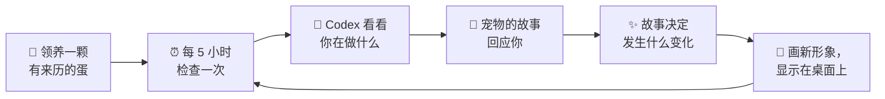

<p align="center">
  <a href="README.md">English</a> · <b>简体中文</b> · <a href="README.ja.md">日本語</a> · <a href="README.ko.md">한국어</a>
</p>

<p align="center">
  
</p>

<p align="center">
  <b>GenPet 是一个 Codex 插件，让桌面宠物和你一起生活：<br>它从蛋孵化、长大，并一直留意你在做什么。</b>
</p>

<p align="center">
  
  
  
</p>

---

Codex 的桌面宠物本来一直是同一个样子。GenPet 的宠物从一颗你在一次小冒险里找到的蛋开始，孵化成专门为你设计的小生物，一路长大，不断变化。

它像住在你家里的猫，只是住在桌面上一个小小的虚拟世界里。它看着你在 Codex 里做什么，并作出反应：你工作时陪着你，你做完或卡住时说句话，或者递给你一样它世界里的小东西。每隔几个小时你会收到一篇新故事，故事让它换了样子，新的样子就出现在桌面上。不用喂它，也不用点它。

## 亮点

- 🥚 **只属于你的蛋。** 每只宠物都从一段"你是怎么得到这颗蛋的"故事开始。蛋壳的颜色和花纹透露了一点线索，但它到底长什么样，要等孵化才知道。
- 🌱 **真的会长大。** 蛋 → 幼年 → 少年 → 成年。成年后，它偶尔会幻化成出人意料的样子，过两天就变回来。每个阶段都会画出全新的形象。
- 🎨 **每一只都不一样。** 没有固定的物种表。每只宠物都根据自己的领养故事单独设计，各个阶段都能认出是同一只。
- 👀 **它会回应你。** Codex 运行时每 5 小时一次，它看看你最近在忙什么，然后用一身新打扮、一份小礼物、家里的变化或几句话来回应。
- 💌 **从它的世界寄来的小东西。** 盖着邮戳的明信片、奖章、自拍照、几格小漫画，还有它的家，家会随着时间慢慢变化。
- 🗣️ **可以和它说话。** 输入 `/genpet-chat`。蛋只会晃一晃，幼年只会发出叫声，长大后会用自己的语气回答你。
- 🧩 **开放，可以改造。** 规则、提示词和生成步骤都是普通文件，你可以阅读、修改、替换，做出属于你自己的宠物玩法。

## 它长什么样

<p align="center">
  
</p>
<p align="center"><sub>蛋 → 幼年 → 少年 → 成年 → 幻化。来自我们测试中的五只宠物，每只都有自己的设计。</sub></p>

<p align="center">
  
</p>
<p align="center"><sub>小溪边寄来的明信片、池塘边的自拍、下雨天的四格漫画，还有河边的新家。</sub></p>

## 快速开始

**需要准备：** Codex 桌面版（带宠物功能），以及 [Node.js](https://nodejs.org) 22 或更新版本。

**1. 安装插件。** 在终端里运行：

```sh
codex plugin marketplace add yate-ge/GenPet
codex plugin marketplace upgrade genpet
codex plugin add genpet@genpet
```

也可以直接让 Codex 帮你装：

> 请按照 https://github.com/yate-ge/GenPet/blob/main/README.zh-CN.md#agent-install 里「给 Codex 的安装步骤」为 Codex 桌面版安装 GenPet 插件

<a id="agent-install"></a>
<details>
<summary>给 Codex 的安装步骤</summary>

1. 运行 `node --version`。GenPet 需要 Node.js 22 或更新版本。没有安装或版本过低时，告诉用户，请用户先安装或升级再继续。
2. 找到能用的 Codex CLI。`codex` 不在 PATH 里时，用桌面 App 自带的那个（macOS 上是 `/Applications/ChatGPT.app/Contents/Resources/codex-cli/bin/codex`，或 `Codex.app` 里的同一路径）。
3. 运行 `codex plugin list`。如果 GenPet 已经来自另一个 marketplace，报告那个来源，不再重复安装。
4. 添加并刷新 marketplace，然后安装：

   ```sh
   codex plugin marketplace add yate-ge/GenPet
   codex plugin marketplace upgrade genpet
   codex plugin add genpet@genpet
   ```

   `marketplace add` 显示 `already added` 不代表已经刷新，仍要运行 `upgrade`。upgrade 超时时先重试再安装，不刷新就安装会装上旧版本。
5. 找到刷新后的 marketplace 目录和实际安装的插件目录，然后运行：

   ```sh
   node <marketplace>/plugins/genpet/scripts/verify-install.mjs \
     <installed-plugin> \
     <marketplace>/plugins/genpet
   ```
6. 报告 marketplace 的 commit、安装的版本、安装路径和校验结果。

更新后的 skills 在新的 Codex 对话里生效。安装本身不会领养、修改或选中宠物。

</details>

**2. 领养你的蛋。** 新开一个 Codex 对话，输入：

```text
/genpet 开始
```

Codex 先说明会用到哪些资料，请你确认。之后你在一段短冒险里做几个选择，最后得到一颗蛋。

**3. 让它出现在桌面上。** 在 Codex 的宠物设置里选中新的宠物（名称显示为 `genpet-xxxxxx`）。GenPet 不会在没问过你的情况下换掉你当前的宠物。

**4. 让它和你一起生活。** 它会在大约 5 小时内孵化，之后每 5 小时检查一次。孵化后，它会邀请你给它起个名字。

### 命令

| 命令 | 作用 |
| --- | --- |
| `/genpet` | 宠物的一切事务，按你说的事来办：领养一颗蛋或继续相处（“开始”）、看近况、起名或改名、暂停或恢复每 5 小时一次的检查、换一只或再养一只、切换 Codex 桌面宠物、查问题 |
| `/genpet-chat` | 和你的宠物说话 |
| `/genpet-debug` | 测试用：打开本地页面查看宠物的记录、立刻来一篇新故事，或直接进入下一个阶段（成年宠物则幻化，幻化中则变回原样；执行前先确认） |

## 它是怎么运作的



- **一切变化都来自故事。** 宠物不会无缘无故地变。每篇故事决定它这次是换了打扮、送你一样东西、改了家里的布置、长到下一个阶段，还是幻化。
- **成长有节奏。** 积累够了，它可以提前长大；就算没有，也会按时长大：蛋最晚 5 小时孵化，幼年和少年各最多持续一周。
- **始终是同一只。** 它的设计、性格、家和经历都保存在一起，所以每个新样子都还是它。
- **建立在 Codex 之上。** 故事由 Codex Agent 来写，形象用 Codex 自带的图像生成来画；GenPet 负责保存记录、管理图像文件，并把新形象换到桌面宠物上。

## 你的数据与我们的原则

- **读之前先问你。** Codex 记忆、你最近的对话、你在领养旅程里的选择和你与宠物的聊天，会用于设计宠物和写故事，但都要你确认后才读。保存简短的摘要和出处；敏感和隐私细节不使用、不保存。
- **不编造关于你的事。** 宠物的世界是想象出来的，但它不会编造你做过什么、有什么感受、说过什么。
- **安静地陪着。** 它不催你，不向你提问，也不把成长显示成数字或进度条。
- **记录留在你这里。** 记录保存在 `~/.genpet/desktop/pets/<id>/`。验收后的整套形象和宠物简介上传到同一个云端 Pet，用于跨设备使用。
- **不控制你的屏幕。** GenPet 通过 Codex 自带的宠物功能来换宠物的形象，不会接管你的鼠标或屏幕。

## 路线图

GenPet 还在早期预览阶段，变化很快。接下来我们在做：

- [ ] **更懂你。** 更贴近你真实的工作和反馈来回应，不编造任何关于你的事。
- [ ] **宠物不见了，能自己找回来。** 桌面上看不到宠物时，GenPet 会查明原因，帮你把它找回来。
- [ ] **画得更快更顺。** 换新形象时，更少重画，更少等待。
- [ ] **去更多地方生活。** 在 Codex Dots 等更多地方使用同一只宠物。

## 开发者

GenPet 分为三层，大多数改动只涉及其中一层：

| 层 | 位置 | 决定什么 |
| --- | --- | --- |
| 产品原则 | [`plugins/genpet/skills/genpet/principles.md`](plugins/genpet/skills/genpet/principles.md) | 宠物、蛋、故事和家必须是什么样（原则的唯一来源） |
| 生成 | [`plugins/genpet/skills/genpet/`](plugins/genpet/skills/genpet/) | 每个步骤一份提示词：领养、设计、故事、形象、家…… |
| 工程 | [`src/`](src/) | 身份、保存、重试、图像文件和桌面宠物的换形象 |

先看 [设计文档](docs/DESIGN.zh-CN.md)，了解设计思路、原则和框架；再看 [贡献指南](CONTRIBUTING.md)，其中也有发布流程。开发需要 Node.js 22+：

```sh
npm ci && npm run verify:fast
```

这套做法并不局限于宠物或 Codex：产品规则划定边界，Agent 做创作上的决定，少量代码保证身份和记录可靠。你可以用它为其他 Agent 和应用打造伙伴。欢迎提出想法、Issue 和 Pull Request。

## 研究背景

GenPet 的思路来自我们的研究 **GenFaceUI**（[CHI '26](https://arxiv.org/abs/2602.11055)）：一个面向生成式、个性化智能体界面的元设计框架。设计者制定规则，每只宠物在规则之内生成。GenPet 怎样运用这个思路，见 [设计文档](docs/DESIGN.zh-CN.md#设计思路)。

## 更新记录与许可证

各版本的改动见[更新记录](CHANGELOG.md)。GenPet 使用 [MIT 许可证](LICENSE)，第三方声明见 [THIRD_PARTY_NOTICES.md](THIRD_PARTY_NOTICES.md)。
