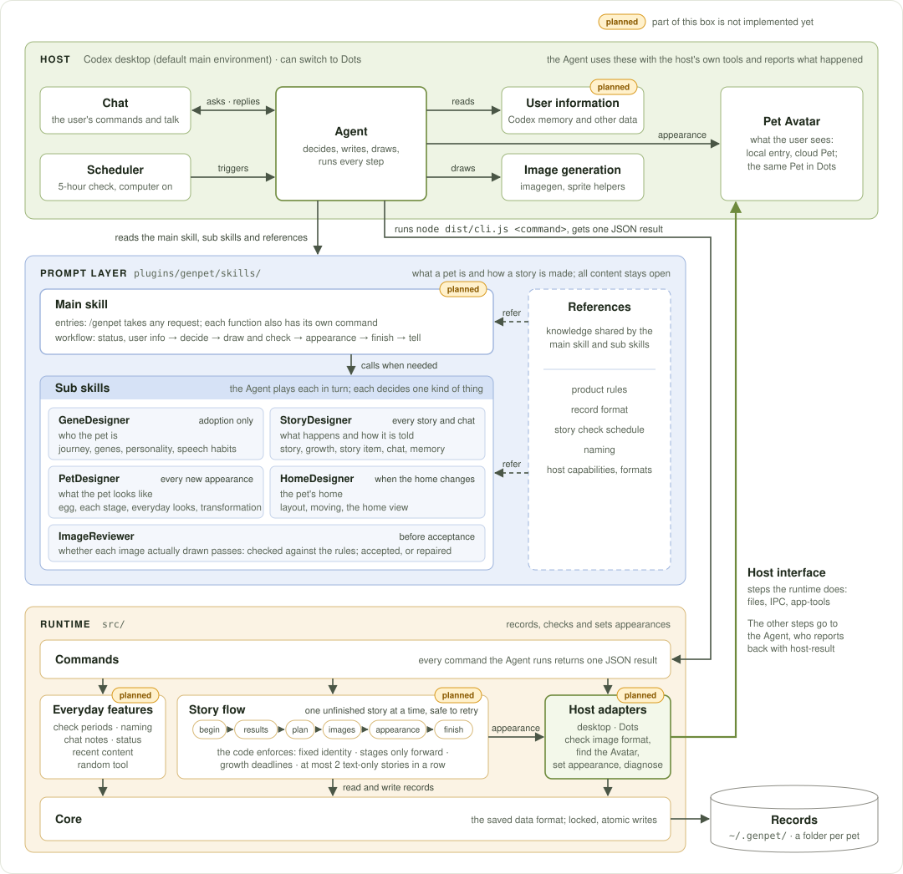
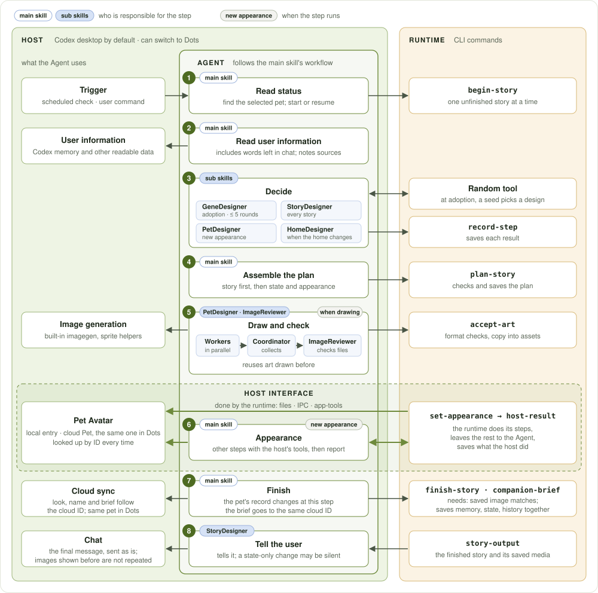

# Architecture

[中文](ARCHITECTURE.zh-CN.md)

This is the target architecture agreed on 2026-10-10. Implementation of the 0.10.0 development package began on 2026-10-11. The diagrams retain the original planning labels; the current source and acceptance status is in the [implementation tracker](evidence/README.md). Passing source checks does not establish visual quality, actual display, scheduling or cross-end Dots behavior.

## Principles

1. **The Agent decides, the runtime records.** Creative content and decisions live in the prompt layer. `src/` handles identity, saved records, retries and putting a new appearance on the Pet Avatar.
2. **The host is a layer.** User information, image generation, scheduling and the Pet Avatar are things the host provides. Each one is either called by the runtime, or used by the Agent with the host's own tools and reported back. Both paths follow the same steps.
3. **A new appearance is checked in four separate ways.** Files written, saved image matches, refresh requested, display confirmed. Each is saved and judged on its own.
4. **Each rule is written once.** A rule lives in one file; other files link to it.
5. **Imports go one way.** Upper parts import lower ones: commands → story flow and everyday features → host adapters → core.

## Layers



| Layer | Where | Decides |
| --- | --- | --- |
| Host | Codex desktop (main environment by default), Dots (can become the main environment) | Provides the Agent and what it uses: user information, image generation, scheduling, the Pet Avatar. |
| Prompt layer | `plugins/genpet/skills/` | What a pet, story, egg and Avatar must be, and how one story is made. Content stays open; the Agent decides it at runtime. |
| Runtime | `src/` | Identity, saved records, retries, artwork files and putting a new appearance on the Pet Avatar. |

Inside the host, the Agent is the center. The user's commands and talk reach it through chat, and the scheduler triggers it for the 5-hour check while the computer is on. The Agent reads user information, draws with image generation, and puts new appearances on the Pet Avatar, which is what the user sees. The runtime reaches the Pet Avatar too, through the host interface.

The three layers exist once in each of two environments, the desktop and Dots, and one of them is the main environment; see [Two environments](#two-environments).

The three layers are connected through the Agent. The Agent reads the prompt layer to know what to do, and runs the runtime's commands to save and check each step. The runtime's host adapters reach the Pet Avatar through the host interface.

The **Pet Avatar** is the host's own entry that shows the pet: the Pet in Codex, which is the local entry under `CODEX_HOME/pets/` and the cloud Pet it maps to. The cloud Pet has a cloud ID and Codex syncs it; selecting the same cloud ID in Dots shows the same Pet. The host also owns its list, selection and refresh. GenPet keeps the pet's record and artwork files under `~/.genpet/`.

## Prompt layer

Logically the prompt layer is skills: one main skill, a few sub skills, and a set of references. The Agent in the host reads and runs all of them.

The **main skill** handles the basics:

- Entries: `/genpet` takes any request and the Agent picks what to do from what the user said. Each function also has its own command: start, chat, story, grow, stop, reset and the debugger; the choices are in [the development plan, "命令入口"](DEVELOPMENT_PLAN.zh-CN.md#命令入口).
- Telling talk, a story and diagnosis apart; see [Three kinds of request](#three-kinds-of-request).
- The main workflow: read status and user information → decide → draw and check → appearance → finish → tell the user.

It calls a sub skill only when one kind of thing has to be decided.

| Sub skill | Decides | Called |
| --- | --- | --- |
| GeneDesigner | Who the pet is, its soul: the adoption journey (the user chooses, up to 5 rounds), genes and personality (with its speaking habits). | Adoption only |
| StoryDesigner | What happens and how it is told: the story, growth, the story item (one thing in the story worth seeing, drawn as one image), and replies in chat; it updates the pet's memory when a story finishes. | Every story and chat |
| PetDesigner | What the pet looks like: the egg, each stage, everyday looks, a transformation, and how each animation slot is expressed. | Every new appearance |
| HomeDesigner | The pet's home: layout, moving, the home view. | When the home changes |
| ImageReviewer | Whether an image that was actually drawn passes. | Before an image is accepted |

The four Designers decide; ImageReviewer checks the result. It looks at the actual generated file (full size and at the size the host shows it), against the product rules and what the Designer wrote the image must show, and the answer is accept or repair.

Sub skills are roles the same Agent plays in turn. They are called in two orders:

- **Adoption**: GeneDesigner → PetDesigner → ImageReviewer.
- **A later story**: StoryDesigner → PetDesigner (only for a new appearance) → HomeDesigner (only when the home changes) → ImageReviewer (before acceptance).

**References** are the knowledge the main skill and the sub skills share: product rules, the record format, the story check schedule, naming, and what each host can do and its formats. Whichever skill needs one refers to it, and each rule is written there once.

**Current source.** The main skill loads five internal Designer/Reviewer documents as needed. These documents add no menu entries. Thin commands share the workflow and product rules; twelve units can be checked independently with `unit-request` and `verify-unit`.

| Sub skill | Units today |
| --- | --- |
| GeneDesigner | `encounter`, `genes`, `personality` (including speaking habits) |
| StoryDesigner | `context`, `story`, `evolution`, `story-item`, `chat`, `output` (memory commits with the story) |
| PetDesigner | `appearance` |
| HomeDesigner | `home` |
| ImageReviewer | `ImageReviewer` |

`context` serves both: at adoption it gives GeneDesigner the user's traits, and afterwards it gives StoryDesigner the user's activity.

Everything the Agent reads lives in `plugins/genpet/skills/genpet/`: `rules.md` (product rules), `output.md`, `context/` (reading user context), `designers/<Role>/` (each role's README and the units it owns), `flows/` (adoption, each story, naming, scheduling) and `host/` (desktop, Dots, storage and unit contracts). See [Where each rule is written](#where-each-rule-is-written).

## One story, end to end



In the diagram, the blue label at the top left of a step is the skill responsible for it, and the grey label at the top right is when the step runs: step 5 only when the story has images, step 6 only for a new appearance.

1. Resolve the host selection to a Pet ID; `begin-story` opens one unfinished story for a stable trigger. Retries keep the same story, and later steps keep its starting Pet ID.
2. Before `context`, the Agent reads actual available sources and records success, unavailability or failure and source references. First adoption requires explicit consent before reading. See [User information](#user-information).
3. The Agent loads the needed roles and saves results with `record-step`. `random-source` selects a source type; `random-choice` selects among open proposals using the seed and recent content. `journey-step` saves an offered scene and the user's real choice, up to five rounds, with interruption recovery.
4. `plan-story` checks and saves the plan once. Artwork retries keep it.
5. A state that was drawn before is reused. For a new image the Agent draws, ImageReviewer checks the actual file, and `accept-art` copies it into the pet's assets under the plan's request ID.
6. The new appearance goes through the [host interface](#host-interface) onto the pet's own Pet Avatar, found by ID.
7. `finish-story` atomically saves memory, state, history and trigger, including whether the appearance actually changed. `companion-brief` extracts the current brief; the Agent updates the same cloud ID's description and reads it back.
8. `story-output` returns the finished story and its saved media for StoryDesigner to tell the user. A check that only changed the state may have no message, and each image appears in the chat once.

Most ordinary checks are a new look: the pet's appearance changes, and a look drawn before is reused. A text-only story skips steps 5 and 6 and can run at most twice in a row. "Every check has pet content" uses this same flow; the story types are in [the development plan, "故事类型"](DEVELOPMENT_PLAN.zh-CN.md#故事类型).

## Host interface

![In the runtime, the story flow calls the host adapters. They implement the four functions of the host interface. Each step of the desktop adapter is done by the runtime or left to the Agent; the Dots adapter is used when Dots is the main environment, targets the same cloud Pet, and its steps are still to test. Runtime steps reach the Pet Avatar in the host directly; the Agent does the other steps with the host's own tools and reports with host-result. Below, the four appearance checks; finish-story requires the second.](assets/architecture/host-interface.svg)

Every host difference between the two environments sits behind one interface, implemented by the runtime's host adapters. The story flow calls only this interface.

| Function | Purpose |
| --- | --- |
| `validateArt` | Check that an image is in this host's format. |
| `findAvatar` | Find the actual Pet Avatar for this pet, including a cloud ID that the host mapped a local entry to. |
| `setAppearance` | Put the new appearance on the Pet Avatar: do the steps the runtime can do, and return the steps left for the Agent. |
| `diagnose` | Read-only check of the record, the Avatar ID, the host's Pet list, the local-to-cloud mapping, the selection, the refresh channel and the scheduled task. The initialization check and diagnosis both use it. |

**The same steps in both environments, on the same cloud Pet.** `set-appearance` (working name) runs `setAppearance`. The remaining steps come back as a list for the Agent, who does it with the host's own tools and reports with `host-result`. On the desktop the runtime writes the local entry and requests the IPC refresh itself; which of the remaining steps the runtime can do is decided by [host tests](#host-tests). When Dots is the main environment it uses the same atlas format and sets the image for the same cloud ID; how each step is done is tested when Dots is adapted.

**Which Avatar gets the new appearance.** The record keeps the pet's local Avatar ID and the cloud ID last found for it. The host owns the mapping, so `findAvatar` asks the host again every time. A local `custom:` entry and the `pet_` ID it migrated to are the same Pet: the new image goes to the cloud ID, the refresh covers the cloud Pet resources, and the Pet counts as active when the host's selection matches either ID.

**Four checks, and when a story can finish.** Each appearance change saves four results separately:

1. Files written: the write or upload itself succeeded.
2. Saved image matches: the image read back from the host is the same as the accepted image.
3. Refresh requested: the request was delivered.
4. Display confirmed: only when the host can show what is on screen; otherwise it stays unknown.

A story with a new appearance can finish once check 2 passes. If the host cannot be reached at all, the story may finish with a clear note, and the files show when the host next loads them. If the host is reachable but its saved image is different, the story stays unfinished and the next check retries. All four checks go through the host's own interfaces: host APIs, app-tools, IPC and the plugin runtime.

## Two environments


The host, skills and runtime exist once in Codex desktop and once in Dots. There is one main environment at a time, and stories and new appearances are made there; it is Codex desktop by default. Three links connect the two environments:

| Link | What it does | Status |
| --- | --- | --- |
| 1. One pet through its cloud ID | The main environment puts the new appearance on the cloud Pet and Codex syncs it to both sides. In Dots the user selects the Pet with the same cloud ID. Each pet has its own cloud ID. | Sync tested by the user; setting the cloud Pet's image is planned |
| 2. Dots becomes this pet | Dots takes the pet's look and replies in its speaking style, and its own functions stay as they are. After every finished story the code takes a pet brief out of the pet's record: its name, soul, memory and state; see [Records](#records). | Planned; how the brief reaches Dots (first try: the Pet entry's `description`) and how the style stays in effect are to test |
| 3. Switch the main environment | The user can switch the main environment to Dots. The old environment stops its scheduled checks, the record moves, and the new environment continues the stories. | Planned; setting the appearance for the same cloud ID from Dots is to test |

The speaking style comes from two parts of the record: the pet's sounds and basic speaking habits are written in the personality in its soul, and how close and in what tone it talks to the user comes from its memory. It is used in three places: when the user talks to the pet, in what the pet says in stories, and in Dots' replies.

Dots keeps working as before. While the pet is an egg, Dots speaks as it always did and only its look changes; for a hatchling, one short sound is added at the start or end of a reply; a juvenile or adult speaks from its personality and how it and the user get along now. The speaking style applies only to what Dots says to the user; the code, documents and messages Dots produces for the user stay as they are.

Development has two phases: the desktop and link 1 first, then the Dots adaptation with links 2 and 3. The questions to test for each and the approaches to try are in [the development plan, "Dots 联动"](DEVELOPMENT_PLAN.zh-CN.md#dots-联动).

## User information

Reading user information is something the Agent does before writing.

- A host reference lists what each host has been tested to let the Agent read, and the limits.
- The workflow puts the reading step before the `context` unit, for adoption and for every later story.
- The `context` unit's existing `inputRefs` record where each piece came from. "Could not read" and "nothing new" are saved as different results.

The Agent chooses which information matters and how far back to look.

## Three kinds of request

`/genpet` and explicit GenPet requests lead to one of three things. The Agent picks from what the user asked:

| Request | When | How the reply reads |
| --- | --- | --- |
| Conversation | The user talks to the pet with `/genpet-chat`. Runs the `chat` unit and may save a chat note. | In the pet's voice |
| Story | A scheduled, proactive or explicit trigger. Runs the full flow above. | In the pet's voice |
| Diagnosis | "Load my pet", "it isn't showing", "I can't find it". Runs `diagnose`, fixes what it actually found, then checks again. It works on the host side only; the pet itself stays as it is. | Plain and direct |

## Runtime modules

The runtime has five parts, matching the runtime layer in the diagram:

- **Commands**: every command the Agent runs enters here and returns one JSON result.
- **Everyday features**: check periods, naming, chat notes, status and brief, recent content and seeded candidate selection.
- **Story flow**: begin → units → plan → images → appearance → finish. Code preserves identity, one pending story, valid stage advances, experience/deadline growth and at most two consecutive text-only stories.
- **Host adapters**: desktop and cloud share the cloud Pet format and same-ID update path. They validate, locate, update, verify stored artwork and diagnose.
- **Core**: the saved data format, locking and atomic writes. The other parts read and write records through it.

The files behind each part:

| Group | Files | What it does |
| --- | --- | --- |
| Command table | `cli.ts` | Shared commands plus the package host's commands; help is generated. |
| Story | `lifecycle.ts` | `begin`, `plan`, `finish`, `cancel`, `reset` and `story-output`. |
| | `growth.ts` | Growth deadlines: which stage advance or transformation end the next story must include; a transformation is never forced in and cannot start again within a week. |
| | `art.ts` | `art-request` (what to draw) and `accept-art` (format checks, copy into assets). |
| | `generation.ts` | `unit-request`, `verify-unit` (field checks only) and `record-step`. |
| Everyday features | `schedule.ts` | Check periods, the saved schedule reference, time since the last story. |
| | `naming.ts` | One naming invitation after the hatch; saves only the user's own answer. |
| | `chat.ts` | Brief notes of what the user told the pet. |
| | `status.ts` | The short summary the Agent reads by default. |
| Host adapters | `hosts/index.ts` | The host interface and the list of adapters. |
| | `hosts/result.ts` | Checks and saves what a host did (`host-result`). |
| | `hosts/desktop/` | Desktop Pet: `atlas` format, `publish` to one entry per pet, `refresh` through the IPC router, `switch` the visible Pet (the user's test on 2026-10-11 found switching does not work; to be retested), shared `frames` codec. |
| | `hosts/cloud.ts`, `hosts/identity.ts` | Shared cloud Pet adapter, actual migration mapping and same-ID lookup; the former `hosts/dots.ts` is removed. |
| Core | `model.ts` | Saved data types and small validators. |
| | `store.ts` | Read without side effects (`peek`), locked `transaction`, atomic writes. |
| | `pending.ts`, `appearance.ts` | Pending reads, request IDs and artwork resolution without a host dependency. |
| Everyday | `journey.ts`, `variety.ts` | Journey recovery and seeded source/candidate choices. |
| Image support | `pipeline.ts`, `vendor/hatch-pet/` | Python discovery, parallel jobs after the base, directional mirrors, deterministic processing, bounded repairs and the final-image gate. |
| Support | `config.ts`, `image.ts`, `migration.ts` | Paths and prompt files; pure-JS PNG/WebP reading; explicit import of v1 desktop records. |
| Debugger | `debugger/` | Optional local developer console for this machine's GenPet records: stories, homes, saved atlases with action preview and debug appearance display; other host Pets in a secondary list; records are never changed. |

**Import rule.** `cli` → Story and Everyday features → Host adapters → Core; imports follow this direction only. Files stay in the flat layout; the groups describe the import rule.

The former dots/lifecycle and publish/art cycles are removed. Pending reads live in Core; image validation and host diagnosis use the interface. The debugger inspects the requested Pet without activating it.

## Records

```
~/.genpet/<host>/
  registry.json        active ID, bindings and pause ledger
  pets/<pet>/state.json pet, pending, history references, art and schedule
  pets/<pet>/stories/  story/unit files, read by committed prefix
  pets/<pet>/assets/    accepted artwork
  backups/              full record before a reset or a legacy import
```

Records live in the main environment. `GENPET_DATA_DIR` sets the root, with desktop/cloud subdirectories. Moving a Pet's main environment to the other host is shelved (never validated on a real host); a record exported by an earlier version stays read-only. Writes are locked and atomic; units live in separate files. Legacy records are discovered read-only and imported after confirmation. Fields are described in `plugins/genpet/skills/genpet/host/storage.md`.

The v3 `pet` has identity and three blocks. A story commits shared memory and current state; naming changes only the name:

```
pet
  id, name, naming, adoptedAt, revision, Avatar ID   identity, managed by code
  soul    { genes, personality, acquisition }        who it is
  memory  { text, updatedAt, storyId }               what it remembers
  state   { stage, description, home, special }      how it is now
```

| Block | Holds | Written by, and when |
| --- | --- | --- |
| soul | Genes, personality (with its sounds and speaking habits), how it was adopted | GeneDesigner, once at adoption; it stays the same afterwards |
| memory | One short text: the important things that happened between the pet and the user, and how they get along now | StoryDesigner, when a story finishes; rewritten only after a real interaction worth remembering |
| state | Stage, the description of its current state, home, transformation (field `special`) | StoryDesigner and HomeDesigner, every time a story finishes |

Memory records shared experiences; knowledge about the user comes first from host memory. Legacy fields map into the three blocks. Missing memory/speaking habits can be supplemented once after confirmation from existing records; the initial supplement adds no experience and preserves the original personality text.

Each GenPet has its own directory, artwork and binding. Readable host selection resolves the one active Pet; failed reads keep the last active record, and inactive time is frozen. The main skill checks existing resources with actual host tools and handles the user's choice. Cross-end selection and intake still need real-host acceptance. See [the requirements](DEVELOPMENT_PLAN.zh-CN.md#初始化检查领养新宠物和多只宠物).

## Where each rule is written

| Kind of rule | Written in |
| --- | --- |
| What a pet, egg, story and Avatar must be; how often stories come; how the user appears in them | `plugins/genpet/skills/genpet/rules.md` |
| When a role works, which units it runs in what order, where results go | `plugins/genpet/skills/genpet/designers/<Role>/README.md` |
| One unit's inputs, result and review points | That unit's prompt in its role folder and its entry in `plugins/genpet/skills/genpet/host/units.json` |
| How user context is read | `plugins/genpet/skills/genpet/context/` |
| The order of steps and which command to run | `plugins/genpet/skills/genpet/flows/` |
| What a host can do and its formats | `plugins/genpet/skills/genpet/host/desktop.md`, `dots.md` |
| What the user sees | `plugins/genpet/skills/genpet/output.md` |
| When a command applies and whether it needs the user's confirmation | The skill, which otherwise only links to the files above |
| Code guarantees: identity, pending, stage/experience/deadline growth, binding and two consecutive text-only stories at most | `src/` |

Each rule is written once, in the place the table names; other files point to its section instead of restating it. The directory conventions are in AGENTS.md "GenPet repository layout". Contract validation does not replace semantic or visual review.

## Implementation status

| Part | 0.10.0 development source | Acceptance still needed |
| --- | --- | --- |
| v3, legacy records, separate units, multiple Pets and pause ledger | Implemented; isolated regressions pass | Actual intake and cross-end M cases |
| Journey recovery, five-round cap, seeded source/candidate tools | Implemented; six designs and full hatchling sets; overall direction accepted by user | Seeded-hatch supplements do not prove six cold adoptions |
| Memory, experience/deadline growth, transformations (formerly special forms), text-only cap | Implemented;380 independently reviewed revised text views;actual D growth/F special-form submissions | Actual host deadline wake and displayed artwork |
| Main entry, chat, naming and five internal roles | Implemented; twelve unit contracts | Actual routing and one menu entry per command |
| validateArt/findAvatar/setAppearance/diagnose | Implemented; migration mapping, same-ID updates, separate downloads and supported refresh tested | Actual displayed image remains unavailable from these interfaces |
| Same-ID cloud updates and actual artwork fingerprints | Implemented; actual V1–V4 stored RGBA and brief readbacks match | Dots own-avatar linkage |
| Parallel images, mirrors, bounded repairs and two reviews | Implemented; new B travel set 17m42s and D mechanic set 13m24s, including 9 actions/16 directions, review, same-ID update and pixels/brief readback, no prior-art fallback | Current target20minutes; a few results are not a universal guarantee |
| Diagnosis, same-identity repair and read-only debugger | Implemented; isolated browser reads preserve records | Actual G host conditions |
| Pet brief and one writer | Implemented; isolated protocol tests pass. Main-environment transfer shelved on 2026-10-15 | New Dots sessions and actual cross-end scheduling/readback |
| Persistent Dots voice, setup and proactive exchange | Same-session stage/state replies and reported shared-rule readback observed | New-session and cross-environment work deferred at user's request |
| One plugin, generated copies, version and install integrity | Separate genpet-dots removed;latest isolated0.10.0/86hash release gate passed | Actual menu and public release not yet performed |

See the [evidence index](evidence/README.md) for current status, outstanding cases and cloud archive links. Implemented source and completed probes do not replace outstanding user or host acceptance.

### Host tests

These three facts decide whether a step is done by the runtime or by the Agent.

1. Can the plugin runtime, a Node process, replace a cloud Pet's artwork itself, or can only the Agent call the Pets API?
2. Can the local-to-cloud mapping be read through a host interface, or only from the client's own storage?
3. Can the runtime read back a cloud Pet's saved artwork to compare it with the accepted image?

The six further things to test when Dots is adapted are listed in [the development plan](DEVELOPMENT_PLAN.zh-CN.md#开发要解决的问题).

### Open decision

How the release is delivered. The marketplace clones this repository in full under a 30-second limit, and the history is far larger than the current files. The options are rewriting the history or publishing from a branch that holds only `plugins/` and the marketplace file.

## Extending

- **Change a product rule**: edit `rules.md`. Only touch a unit prompt if its review points depend on that rule.
- **Add or change a generation unit**: keep its prompt in the owning role's folder and update its entry, including `file`, in `host/units.json`. `unit-request` and `verify-unit` pick it up.
- **Add a host**: write an adapter that implements the host interface and adds its own commands. Register it in `hosts/index.ts`, add `config/host.json` and a plugin directory, add the package name to `scripts/build-plugin.ts`, and write its reference with what you tested the host can do.
- **Add a command**: add an entry to the command table in `cli.ts`, or to the host adapter's `commands` if only one host needs it. Keep the logic in the feature module.
- **Change a skill**: edit `plugins/genpet/skills/` directly; it is the only copy.

## Packages

`npm run build:plugin` bundles `src/` into `dist/` and writes the package's `package.json`. Everything else in `plugins/genpet/` (manifest, skills, debugger page, host config, README, install verifier and the vendored image pipeline) is edited in place. Dots installation and persistent loading require actual host validation.

## Checks

`npm run verify:fast` checks types, formatting and unit tests. `npm run verify:release` additionally builds and installs GenPet into an isolated Codex home, checks all installed file hashes, and runs its CLI/debugger. Outputs and fixtures are retained under output/ and uploaded to Google Drive. These checks cover engineering; actual stories and images are reviewed with `tests/agent/README.zh-CN.md`.
